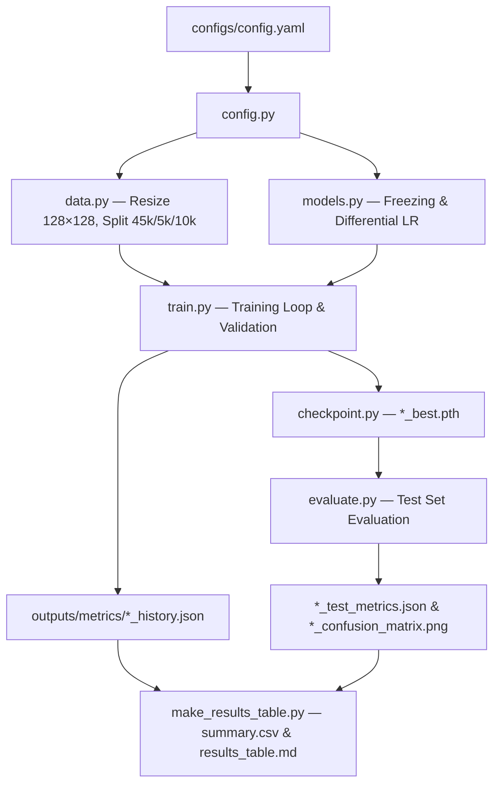

# Lab 2: Pretrained Models, Transfer Learning & Fine‑Tuning (CIFAR‑10)


## Overview

So sánh hai phương pháp sử dụng pretrained models trên CIFAR‑10:

- **Transfer Learning (Feature Extraction):** Đóng băng toàn bộ backbone, chỉ huấn luyện classifier head mới.
- **Fine‑Tuning:** Đóng băng các lớp đầu, mở khóa các block sâu nhất và áp dụng **Differential Learning Rate** ($\eta_{\text{backbone}} = 0.1 \times \eta_{\text{head}}$).

Hai kiến trúc được thí nghiệm: **ResNet‑18** và **DenseNet‑121**, tổng cộng 6 cấu hình bao gồm các biến thể learning rate và batch size.

## Features

- Mã nguồn module hóa: config, data pipeline, models, training loop, evaluation, checkpointing, TensorBoard logger.
- 6 thí nghiệm cốt lõi (ResNet‑18 & DenseNet‑121 × Transfer & Fine‑Tuning, cộng biến thể LR và batch size).
- 53 automated tests (unit & integration) qua pytest.
- Script tự động sinh bảng kết quả CSV, Markdown và confusion matrix.
- Hỗ trợ `--smoke-test` để kiểm tra nhanh (1 epoch).

## Technology Stack

| Thành phần | Công nghệ |
|---|---|
| Ngôn ngữ | Python 3.14 |
| Deep Learning | PyTorch (CPU‑only), torchvision |
| Visualization | matplotlib, seaborn, TensorBoard |
| Data | pandas, numpy, Pillow |
| Testing | pytest, pytest‑cov |
| Config | PyYAML |
| Notebook | Jupyter, nbformat, nbconvert |

## System Architecture



## Project Structure

```
.
├── configs/config.yaml            # Hyperparameters (6 experiments)
├── docs/                          # Lab reports & documentation
│   ├── labs2.md                   #   Scientific report (12 sections)
│   ├── data.md                    #   Dataset documentation
│   ├── model.md                   #   Model documentation
│   ├── training.md                #   Training documentation
│   ├── evaluation.md              #   Evaluation documentation
│   └── audit-log.md               #   Development audit log
├── notebooks/
│   └── Lab2_Practice2_Main.ipynb  # Jupyter notebook
├── outputs/
│   ├── figures/                   #   PNG: confusion matrices, EDA, diagrams
│   ├── metrics/                   #   JSON history, test metrics, summary.csv
│   ├── results_table.md           #   Markdown results summary
│   └── Lab2_Report.html           #   HTML report
├── checkpoints/                   # Best & latest model checkpoints (.pth)
├── runs/                          # TensorBoard event logs
├── scripts/
│   ├── run_experiments.py         #   Run training experiments
│   ├── make_results_table.py      #   Generate results CSV & Markdown
│   ├── inspect_models.py          #   Print model summaries & layer counts
│   ├── evaluate_checkpoints.py    #   Evaluate saved checkpoints
│   ├── check_frozen_bn.py         #   Verify frozen BatchNorm behavior
│   └── visualize_*.py             #   EDA & data visualization scripts
├── src/lab2/                      # Core source code
│   ├── config.py                  #   Configuration loader
│   ├── data.py                    #   Data pipeline & augmentation
│   ├── models.py                  #   Model builder, freezing, differential LR
│   ├── train.py                   #   Training loop
│   ├── evaluate.py                #   Evaluation & confusion matrix
│   ├── checkpoint.py              #   Checkpoint save/load
│   ├── tensorboard_logger.py      #   TensorBoard logging wrapper
│   ├── logger.py                  #   File logger
│   └── utils.py                   #   Shared utilities
├── tests/                         # 53 automated tests
│   ├── test_config.py
│   ├── test_data.py
│   ├── test_models.py
│   ├── test_training.py
│   ├── test_checkpoint.py
│   ├── test_evaluate.py
│   ├── test_frozen_bn.py
│   ├── test_reporting.py
│   └── test_notebooks.py
├── requirements.txt
└── README.md
```

## Requirements

- Python ≥ 3.14
- Các dependency được liệt kê trong `requirements.txt`
- Không yêu cầu GPU (toàn bộ thí nghiệm chạy trên CPU)

## Installation

```bash
# Clone repository
git clone https://github.com/khanhlinh616/DL_Lab2_Nhom1.git
cd DL_Lab2_Nhom1

# (Khuyến nghị) Tạo virtual environment
python -m venv .venv
.venv\Scripts\activate      # Windows
# source .venv/bin/activate  # Linux/macOS

# Cài đặt dependencies
python -m pip install -r requirements.txt
```

## Usage

**Chạy toàn bộ 6 thí nghiệm:**

```bash
python scripts/run_experiments.py --all
```

**Chạy smoke test (1 epoch, kiểm tra nhanh):**

```bash
python scripts/run_experiments.py --smoke-test --experiment resnet18_transfer
```

**Chạy nhóm hyperparameter sweep:**

```bash
python scripts/run_experiments.py --group hparam
```

**Xem cấu trúc model và số lượng parameters:**

```bash
python scripts/inspect_models.py --print-model all
python scripts/inspect_models.py --layers all
```

**Sinh bảng kết quả tổng hợp:**

```bash
python scripts/make_results_table.py
```

**Khởi chạy TensorBoard:**

```bash
tensorboard --logdir=runs
```

## Testing

```bash
python -m pytest -v     # 53 tests
```

Phạm vi kiểm thử: configuration, data loading, model freezing, training loop, checkpointing, evaluation, reporting, notebook execution.

## Results

Kết quả đầy đủ: [`outputs/metrics/summary.csv`](outputs/metrics/summary.csv)

| Experiment | Method | Batch | LR | Test Acc | Thời gian |
|---|---|---|---|---|---|
| resnet18_transfer | Transfer | 16 | 0.001 | 77.98 % | 05m 35s |
| resnet18_finetune | Fine‑Tune | 16 | 0.001 | 90.24 % | 07m 15s |
| densenet121_transfer | Transfer | 16 | 0.001 | 81.34 % | 09m 03s |
| densenet121_finetune | Fine‑Tune | 16 | 0.001 | 90.65 % | 10m 42s |
| resnet18_transfer_lr1e4 | Transfer | 16 | 0.0001 | 78.32 % | 06m 03s |
| resnet18_transfer_bs32 | Transfer | 32 | 0.001 | 79.04 % | 05m 21s |

**Nhận xét:** Fine‑tuning đạt ~90 % test accuracy, vượt transfer learning (~78–81 %) trên cả hai kiến trúc. DenseNet‑121 transfer (81.34 %) cao hơn ResNet‑18 transfer (77.98 %), nhưng fine‑tuning cho kết quả tương đương (~90 %).

## Limitations

1. **CPU‑only** — giới hạn ở 5 epochs, không mở rộng được số epoch hoặc model lớn hơn.
2. **Resize 32→128** — upsampling có thể làm mờ chi tiết ảnh gốc.
3. **BatchNorm buffers** vẫn cập nhật khi model ở `train()` mode dù backbone bị freeze (đã kiểm chứng bằng `scripts/check_frozen_bn.py`).
4. **Single seed** (`seed=42`) — chưa đánh giá variance qua nhiều lần chạy.

## References

- [PyTorch Documentation](https://pytorch.org/docs/)
- [CIFAR‑10 Dataset](https://www.cs.toronto.edu/~kriz/cifar.html) — Krizhevsky, 2009
- [torchvision.models](https://pytorch.org/vision/stable/models.html) — Pretrained weights (`IMAGENET1K_V1`)
- Tài liệu chi tiết: [`docs/`](docs/)
