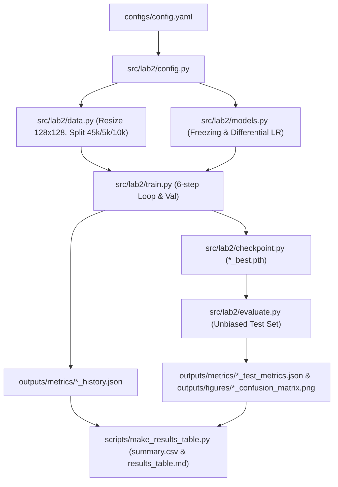

# Lab 2: Pretrained Models, Transfer Learning & Fine-Tuning (CIFAR-10)
Dự án tuân thủ nguyên tắc kỹ thuật: **Source-First, Design-First, Test-Driven, Reproducible và CPU-First**.

## 1. Project Overview
Nghiên cứu, thực nghiệm và so sánh đối chứng việc áp dụng các mô hình học sâu huấn luyện sẵn (`torchvision.models`) trên bộ dữ liệu ảnh CIFAR-10. Trọng tâm là làm rõ cơ chế thích nghi mô hình qua 2 phương pháp:
- **Transfer Learning (Feature Extraction):** Đóng băng toàn bộ backbone, chỉ huấn luyện classifier head mới.
- **Fine-Tuning:** Đóng băng các tầng đầu và mở khóa các khối tích chập sâu nhất kết hợp **Differential Learning Rate** ($\eta_{\text{backbone}} = 0.1 \times \eta_{\text{head}}$) để tinh chỉnh đặc trưng theo miền mới mà không làm mất tri thức học sẵn.
Hệ thống tối ưu hóa cho CPU-First, modular mã nguồn, kịch bản CLI, xuất báo cáo tự động và 53 bài kiểm thử unit & integration.

## 2. Problem Statement
- **Dữ liệu:** CIFAR-10 gồm 60.000 ảnh màu $32 \times 32$ thuộc 10 lớp phân loại cân bằng (6.000 ảnh/lớp).
- **Thách thức kỹ thuật:**
  1. *Khác biệt kích thước:* Ảnh $32 \times 32$ nhỏ hơn chuẩn $224 \times 224$ của ImageNet, cần resize song tuyến lên $128 \times 128$ và chuẩn hóa kênh màu ImageNet.
  2. *Ràng buộc tài nguyên:* Thực thi trên CPU, cần tối ưu luồng dữ liệu, batch size và cờ `--smoke-test` để kiểm tra nhanh pipeline.
  3. *Hành vi BatchNorm:* Khi `model.train()`, các tầng BatchNorm dù `requires_grad=False` vẫn cập nhật `running_mean`/`running_var`.

## 3. Main Features
- **Kiến trúc Modular:** Tách biệt cấu hình (`config.py`), dữ liệu (`data.py`), mô hình (`models.py`), huấn luyện (`train.py`), đánh giá (`evaluate.py`), checkpoint (`checkpoint.py`), và giám sát (`tensorboard_logger.py`).
- **Quy trình chuẩn 6 bước:** `model.train()` $\to$ `zero_grad()` $\to$ forward pass $\to$ compute loss $\to$ backward pass $\to$ `optimizer.step()`.
- **Hỗ trợ đầy đủ Practice 2:** So sánh ResNet-18 vs. DenseNet-121; khảo sát siêu tham số (LR $10^{-4}$, Batch Size 32); giám sát TensorBoard.
- **Test-Driven:** 53 tests tự động bao phủ 100% logic (checkpoint, config, data, evaluate, models, training, frozen_bn, notebooks, reporting).
- **Báo cáo tự động:** Script `make_results_table.py` xuất bảng CSV và Markdown đối chiếu tự động.

## 4. System Architecture


## 5. Folder Structure
```
.
├── configs/config.yaml                 # Cấu hình siêu tham số tập trung (core & hparam)
├── docs/                               # labs2.md, data.md, model.md, audit-log.md, training.md, evaluation.md
├── notebooks/                          # Lab2_Practice2_Main.ipynb, Lab2.html
├── outputs/
│   ├── Lab2_Report.html & results_table.md
│   ├── figures/                        # Trực quan hóa EDA, PCA và Confusion Matrix (*.png)
│   └── metrics/                        # summary.csv, *_history.json, *_test_metrics.json
├── checkpoints/                        # Checkpoint tốt nhất (*_best.pth)
├── runs/                               # TensorBoard event logs
├── scripts/                            # run_experiments.py, inspect_models.py, make_results_table.py, check_frozen_bn.py
├── src/lab2/                           # config.py, data.py, models.py, train.py, evaluate.py, checkpoint.py, utils.py
└── tests/                              # 53 test cases kiểm thử tự động
```

## 6. Installation / Run / Test
```bash
# 1. Cài đặt thư viện phụ thuộc
python -m pip install -r requirements.txt

# 2. Chạy toàn bộ 53 bài kiểm thử tự động
python -m pytest -v

# 3. Kiểm tra kiến trúc và đếm tham số mô hình
python scripts/inspect_models.py --print-model all
python scripts/inspect_models.py --layers all

# 4. Chạy nhanh 1 epoch kiểm thử toàn bộ luồng (Smoke Test)
python scripts/run_experiments.py --smoke-test --experiment resnet18_transfer

# 5. Huấn luyện 4 thí nghiệm cốt lõi hoặc toàn bộ
python scripts/run_experiments.py --all
python scripts/run_experiments.py --group hparam

# 6. Xuất bảng kết quả và khởi chạy TensorBoard
python scripts/make_results_table.py
tensorboard --logdir=runs
```

## 7. Model (Experiment Matrix)
| Experiment ID | Group | Kiến trúc | Phương pháp | Tầng Trainable | Tầng Bị đóng băng (Frozen) | Trainable Params | Tổng Params | Trainable % |
|:---|:---:|:---:|:---:|:---|:---|:---:|:---:|:---:|
| `resnet18_transfer` | core | ResNet18 | Transfer | Duy nhất `fc` | `conv1`, `bn1`, `layer1`..`layer4` | 5.130 | 11.181.642 | 0.05% |
| `resnet18_finetune` | core | ResNet18 | Fine-Tuning | `layer4` + `fc` | `conv1`, `bn1`, `layer1`..`layer3` | 8.398.858 | 11.181.642 | 75.11% |
| `densenet121_transfer` | core | DenseNet121 | Transfer | Duy nhất `classifier` | Toàn bộ `features` | 10.250 | 6.964.106 | 0.15% |
| `densenet121_finetune` | core | DenseNet121 | Fine-Tuning | `denseblock4`+`norm5`+`classifier` | `conv0`..`denseblock3` | 2.170.378 | 6.964.106 | 31.17% |
| `resnet18_transfer_lr1e4` | hparam | ResNet18 | Transfer (LR 1e-4) | Duy nhất `fc` | `conv1`, `bn1`, `layer1`..`layer4` | 5.130 | 11.181.642 | 0.05% |
| `resnet18_transfer_bs32` | hparam | ResNet18 | Transfer (BS 32) | Duy nhất `fc` | `conv1`, `bn1`, `layer1`..`layer4` | 5.130 | 11.181.642 | 0.05% |

## 8. Notebooks
- **`notebooks/Lab2_Practice2_Main.ipynb`:** Triển khai tuần tự 7 bước và 3 bài tập của Practice 2; hỗ trợ cờ `SMOKE_TEST = True/False`; tự động liên kết dữ liệu và trực quan hóa kết quả. Thực thi kiểm thử:
  `jupyter nbconvert --to notebook --execute --inplace notebooks/Lab2_Practice2_Main.ipynb`
- **`notebooks/Lab2.html` & `outputs/Lab2_Report.html`:** Báo cáo HTML thẩm định độc lập.

## 9. Example In-Out
### Lệnh thực thi mẫu (Smoke Test trên CPU):
`python scripts/run_experiments.py --smoke-test --experiment resnet18_transfer`
### Trích xuất Console Output thực tế:
```text
EXPERIMENT RUNNER: resnet18_transfer | Smoke Test Mode: True
Train samples: 120 | Val samples: 30 | Test samples: 30
Model: resnet18 | Method: transfer | Trainable Params: 5,130 / 11,181,642 (0.05%)
Epoch [01/01] Time: 00m 01s | Train Loss: 2.5788 - Acc: 11.67% | Val Loss: 2.2786 - Acc: 10.00% * [Best]
Saved: ./checkpoints/resnet18_transfer_best.pth
Evaluation Results: Test Loss: 2.4466 | Test Accuracy: 10.00%
Metrics: ./outputs/metrics/resnet18_transfer_test_metrics.json | CM: ./outputs/figures/resnet18_transfer_confusion_matrix.png
```
### Trích đoạn kết quả JSON (`outputs/metrics/resnet18_transfer_test_metrics.json`):
```json
{
  "experiment_name": "resnet18_transfer",
  "checkpoint_path": "./checkpoints/resnet18_transfer_best.pth",
  "best_epoch": 1,
  "test_loss": 2.4466,
  "test_accuracy": 10.0,
  "total_test_samples": 30,
  "per_class_accuracy": { "airplane": 0.0, "automobile": 0.0, "bird": 0.0, "cat": 0.0, "deer": 100.0, "dog": 0.0, "frog": 0.0, "horse": 0.0, "ship": 0.0, "truck": 0.0 }
}
```

## 10. Results
Bảng kết quả thực nghiệm chính thức từ [`outputs/metrics/summary.csv`](outputs/metrics/summary.csv):
| Experiment ID | Epochs | Batch | LR | Trainable Params | Train Loss / Acc | Best Val Acc (epoch) | Test Loss | Test Acc | TB/Epoch | Tổng thời gian |
|:---|:---:|:---:|:---:|:---:|:---:|:---:|:---:|:---:|:---:|:---:|
| `resnet18_transfer` | 5 | 16 | 0.001 | 5.130 | 0.7718 / 73.85% | 77.94% (ep 2) | 0.6644 | **77.98%** | 01m 06s | 05m 35s |
| `resnet18_finetune` | 5 | 16 | 0.001 | 8.398.858 | 0.2488 / 91.48% | 91.68% (ep 4) | 0.2989 | **90.24%** | 01m 26s | 07m 15s |
| `densenet121_transfer` | 5 | 16 | 0.001 | 10.250 | 0.6860 / 76.89% | 81.84% (ep 5) | 0.5560 | **81.34%** | 01m 48s | 09m 03s |
| `densenet121_finetune` | 5 | 16 | 0.001 | 2.170.378 | 0.2912 / 89.94% | 90.78% (ep 5) | 0.2982 | **90.65%** | 02m 08s | 10m 42s |
| `resnet18_transfer_lr1e4` | 5 | 16 | 0.0001 | 5.130 | 0.7605 / 73.96% | 77.56% (ep 5) | 0.6643 | **78.32%** | 01m 12s | 06m 03s |
| `resnet18_transfer_bs32` | 5 | 32 | 0.001 | 5.130 | 0.7029 / 76.12% | 78.92% (ep 4) | 0.6276 | **79.04%** | 01m 04s | 05m 21s |

## 11. Limitations
1. **Ràng buộc CPU:** Huấn luyện trên CPU kéo dài thời gian, giới hạn số epoch ở mức 5 epochs cho toàn bộ 45.000 ảnh.
2. **Nội suy phóng đại ảnh:** Bilinear resize $32 \times 32 \to 128 \times 128$ có thể làm mờ nhẹ một số đường viền biên sắc nét.
3. **BatchNorm buffer trong backbone đóng băng:** Ở `train()` mode, buffer của 20 lớp BN (ResNet-18) và 121 lớp BN (DenseNet-121) vẫn cập nhật thống kê running stats theo batch dữ liệu mới (đã xác thực qua `scripts/check_frozen_bn.py`).
4. **Giới hạn đơn seed:** Thực nghiệm cố định trên `seed=42`, chưa tính toán phương sai qua nhiều lần chạy ngẫu nhiên.

## 12. Future Improvements
1. **Eval Mode cho BatchNorm đóng băng:** Giữ nguyên các lớp BatchNorm của backbone ở `module.eval()` trong transfer learning để bảo toàn thống kê ImageNet.
2. **Learning Rate Scheduler:** Bổ sung `CosineAnnealingLR` hoặc `ReduceLROnPlateau` để tối ưu hóa sự hội tụ.
3. **Data Augmentation nâng cao:** Bổ sung RandAugment hoặc CutMix/MixUp nhằm nâng cao độ bền vững.
4. **Thực nghiệm đa seed:** Chạy thực nghiệm lặp lại trên 3–5 seeds để báo cáo kết quả kèm khoảng tin cậy $\mu \pm \sigma$.

## 13. AI Usage
Khai báo chi tiết công cụ, mục đích và đóng góp của sinh viên được trình bày tại [docs/plan-progress-status.md](docs/plan-progress-status.md#5-báo-cáo-sử-dụng-ai-minh-bạch-ai-usage-log).
