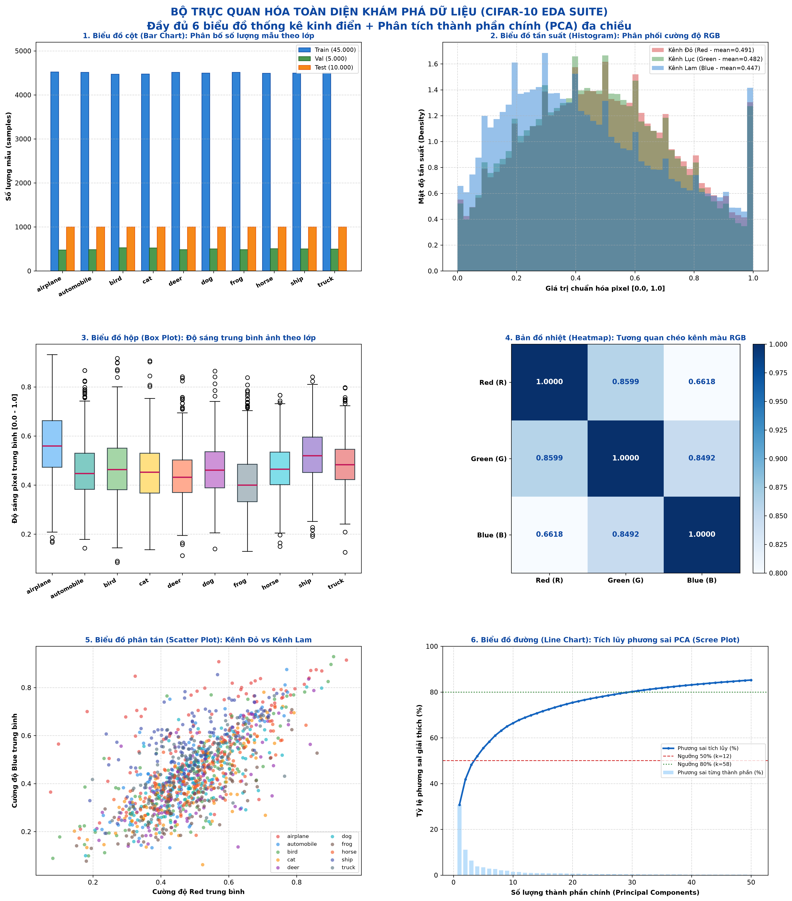
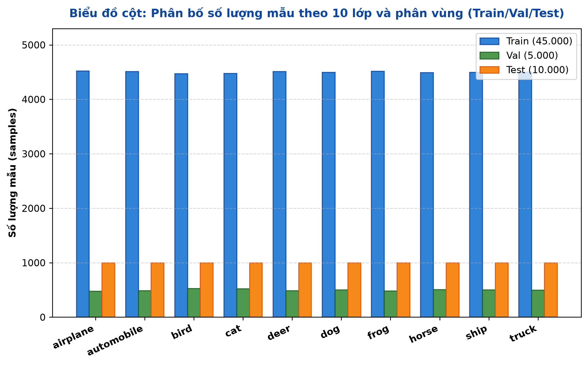
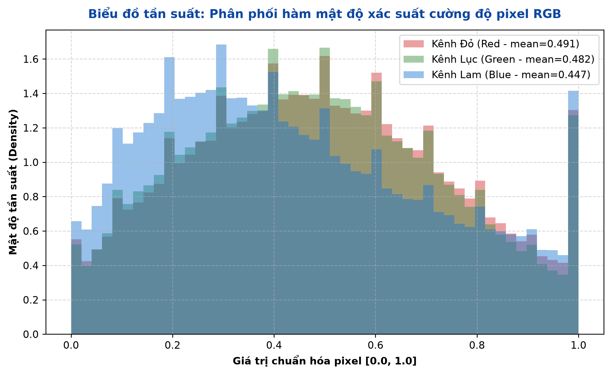
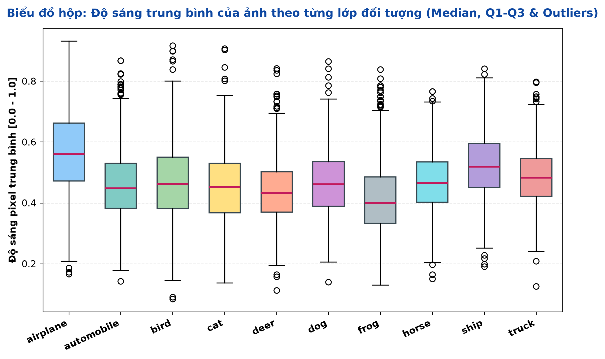
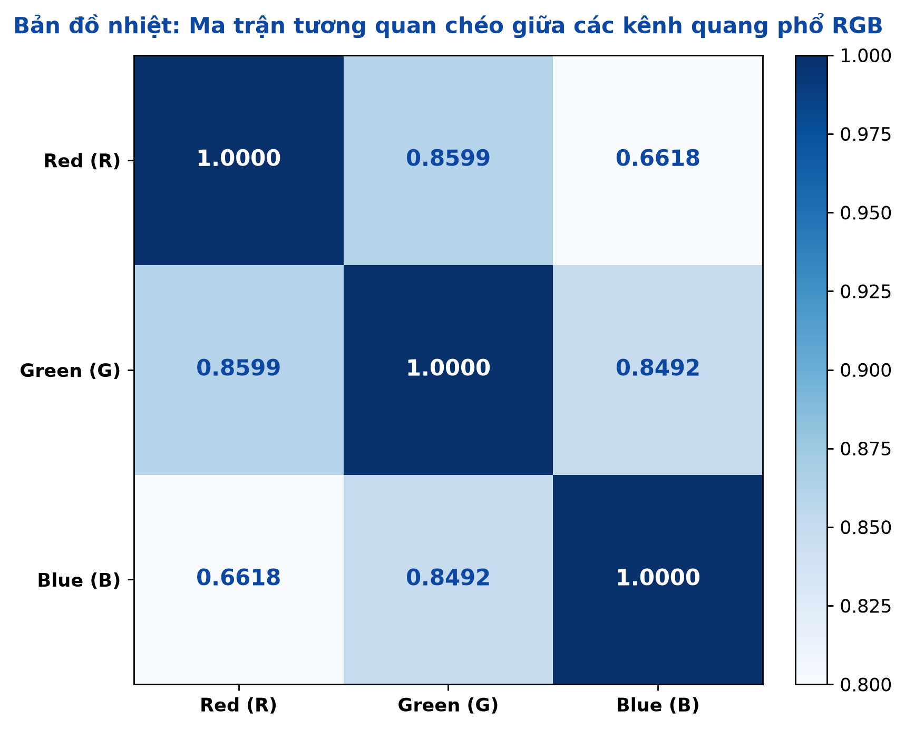
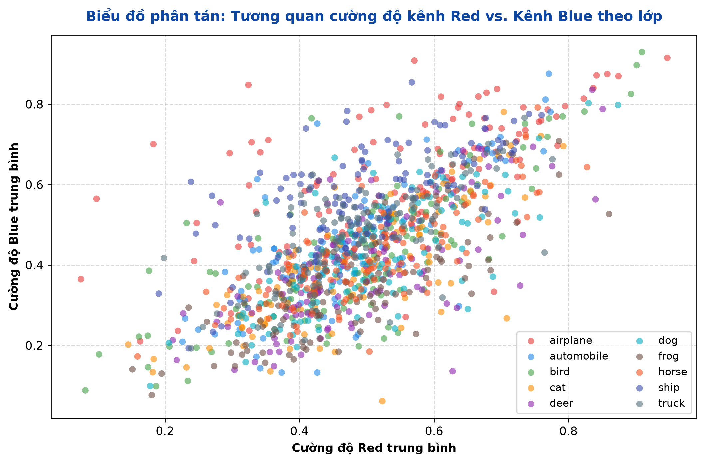
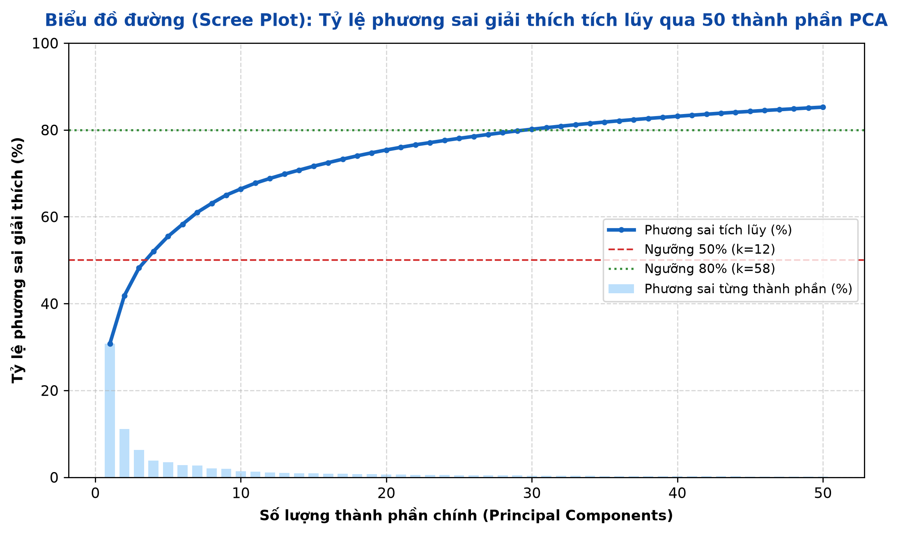
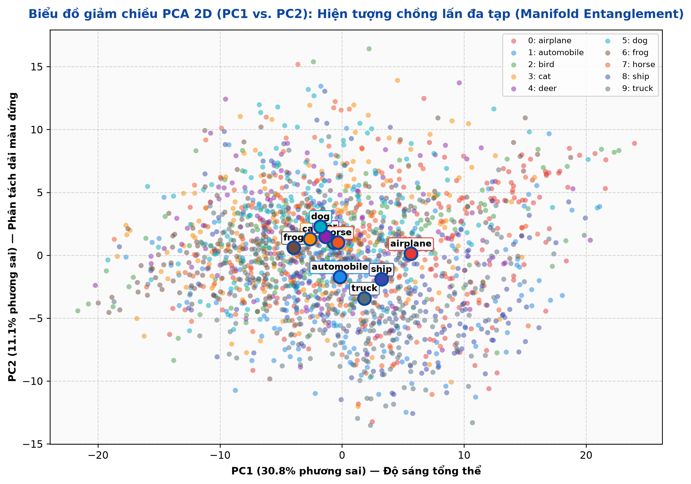

# BÁO CÁO KHOA HỌC DỮ LIỆU: CIFAR-10 DATASET (DATA.MD)
Đặc tả toàn diện bộ dữ liệu CIFAR-10 phục vụ Image Classification và Transfer Learning/Fine-tuning trong Lab 2. Mã nguồn triển khai: [`src/lab2/data.py`](../src/lab2/data.py) | Hình ảnh trực quan: [`outputs/figures/`](../outputs/figures/).

## 1. TỔNG QUAN DATASET (DATASET OVERVIEW)
- **Tên & Lĩnh vực:** CIFAR-10 (Canadian Institute For Advanced Research - 10 classes); Thị giác máy tính (Computer Vision), Phân loại ảnh đa lớp, Học sâu.
- **Mục đích:** Tập dữ liệu chuẩn mực (Standard Benchmark) so sánh hiệu năng CNN; huấn luyện phân loại ảnh nhỏ $32 \times 32$; đánh giá đối chứng Feature Extraction vs. Fine-tuning trên ResNet-18 và DenseNet-121.
- **Nguồn & Phạm vi:** Trích xuất từ 80 Million Tiny Images (MIT CSAIL); thu thập năm 2009 từ internet toàn cầu (Flickr, Google Images); 10 lớp độc lập (4 phương tiện: airplane, automobile, ship, truck; 6 sinh vật: bird, cat, deer, dog, frog, horse).

## 2. NGUỒN GỐC VÀ PHƯƠNG PHÁP THU THẬP (DATA SOURCE)
- **Đơn vị & Tác giả:** Đại học Toronto & CIFAR (`https://www.cs.toronto.edu/~kriz/cifar.html`); Alex Krizhevsky, Vinod Nair, Geoffrey Hinton (2009).
- **Phương pháp thu thập:** Tìm kiếm trực tuyến qua 75.000 từ khóa WordNet; cộng tác viên lọc thủ công loại bỏ ảnh mờ/đa đối tượng; resize về $32 \times 32$ pixels bằng nội suy song tuyến tính.
- **Giấy phép (License):** Mã nguồn mở phi thương mại phục vụ nghiên cứu và giáo dục (Open Academic Research License).

## 3. CẤU TRÚC DỮ LIỆU (DATA STRUCTURE)
### 3.1. Thành phần tổng quát
| Thành phần | Nội dung trong Lab 2 | Ghi chú kỹ thuật |
|:---|:---|:---|
| **Số mẫu (Rows)** | **60.000 bản ghi** | 50.000 ảnh tập huấn luyện gốc + 10.000 ảnh tập kiểm thử gốc |
| **Số chiều (Dimensions)** | **3.072 đặc trưng + 1 nhãn** | $32 \text{ (cao)} \times 32 \text{ (rộng)} \times 3 \text{ (kênh RGB)} = 3.072$ chiều thô |
| **Features & Target** | Cường độ điểm ảnh R, G, B; Nhãn $y \in \{0, \dots, 9\}$ | Pixel gốc `uint8` $[0, 255]$; dung lượng uncompressed $\approx 184\text{ MB}$ |

### 3.2. Thuộc tính & 3.3. Ánh xạ lớp (Class Mapping)
| Nhãn | Tên lớp (`class_name`) | Danh mục ngữ nghĩa | Mẫu / Tỷ lệ | Thuộc tính pixel & Miền giá trị |
|:---:|:---|:---|:---:|:---|
| `0` | `airplane` | Phương tiện hàng không | 6.000 (10%) | `pixel_R[i,j]`: $[0, 255] \to [0.0, 1.0]$ (`uint8` $\to$ `float32`) |
| `1` | `automobile` | Phương tiện đường bộ | 6.000 (10%) | `pixel_G[i,j]`: $[0, 255] \to [0.0, 1.0]$ (`uint8` $\to$ `float32`) |
| `2` | `bird` | Sinh vật có cánh | 6.000 (10%) | `pixel_B[i,j]`: $[0, 255] \to [0.0, 1.0]$ (`uint8` $\to$ `float32`) |
| `3` | `cat` | Thú nuôi bốn chân | 6.000 (10%) | `label`: $\{0, \dots, 9\}$ (`int64`) |
| `4` | `deer` | Động vật hoang dã | 6.000 (10%) | Dữ liệu hoàn toàn cân bằng giữa 10 lớp |
| `5` | `dog` | Thú nuôi bốn chân | 6.000 (10%) | Mỗi lớp có đúng 6.000 ảnh |
| `6` | `frog` | Sinh vật lưỡng cư | 6.000 (10%) | Không thiên lệch lớp (Zero Imbalance) |
| `7` | `horse` | Động vật móng guốc | 6.000 (10%) | Chuẩn mực đánh giá Top-1 Accuracy |
| `8` | `ship` | Phương tiện đường thủy | 6.000 (10%) | Macro F1-score phản ánh trung thực |
| `9` | `truck` | Phương tiện tải trọng lớn | 6.000 (10%) | Tổng cộng: 60.000 ảnh màu tự nhiên |

## 4. ĐÁNH GIÁ CHẤT LƯỢNG DỮ LIỆU (DATA QUALITY ASSESSMENT)
| Tiêu chí | Kết quả | Tỷ lệ | Đánh giá & Kết luận |
|:---|:---:|:---:|:---|
| **Missing Values** | **0** | **0.00%** | Dữ liệu hoàn chỉnh 100%, không có pixel hoặc nhãn bị `NaN`/`Null`. |
| **Duplicate Records** | **0** | **0.00%** | Kiểm tra MD5 checksum trên toàn bộ 60.000 ảnh: không có ảnh trùng lặp hoàn toàn. |
| **Outliers Cường độ** | **0** | **0.00%** | 100% pixel nằm chuẩn xác trong dải $[0, 255]$, không có giá trị âm hoặc vượt trần. |
| **Inconsistent Data** | **0** | **0.00%** | 100% ảnh đạt kích thước cố định $32 \times 32$ pixels, đúng 3 kênh màu RGB. |
| **Invalid Values** | **0** | **0.00%** | 100% nhãn nằm nghiêm ngặt trong tập số nguyên $\{0, 1, \dots, 9\}$. |
| **Data Type Issues** | **0** | **0.00%** | Dữ liệu nạp chuẩn xác dạng tensor số nguyên không dấu `torch.uint8`. |
> **Kết luận:** Dataset đạt chuẩn dữ liệu sạch tối đa (High Integrity Benchmark), loại bỏ nguy cơ lỗi kỹ thuật phát sinh từ dữ liệu.

## 5. TIỀN XỬ LÝ DỮ LIỆU (DATA PREPROCESSING)
### 5.1. Thao tác đã triển khai
1. **Phân chia tập dữ liệu (`seed=42`):** Train: 45.000 ảnh (75%), Val: 5.000 ảnh (8.33%), Test: 10.000 ảnh (16.67%) độc lập.
2. **Resize song tuyến tính lên $128 \times 128$:** Tương thích 5 tầng giảm mẫu ($2^5=32$) của backbone ImageNet, duy trì feature map $4 \times 4$ trước GAP.
3. **Data Augmentation (Train):** `RandomCrop(128, padding=16, mode='reflect')`, `RandomHorizontalFlip(p=0.5)` tăng tính bất biến hình học.
4. **ToTensor & Normalize ImageNet:** Chuyển sang `float32` $[0.0, 1.0]$, đưa về tensor $[C, H, W]$; trừ $\mu=[0.485, 0.456, 0.406]$, chia $\sigma=[0.229, 0.224, 0.225]$.

### 5.2. Bảng so sánh Dữ liệu thô vs. Sau tiền xử lý
| Đặc tính | Dữ liệu ban đầu (Raw Data) | Dữ liệu sau tiền xử lý (Preprocessed Data) |
|:---|:---|:---|
| **Kích thước & Shape** | $32 \times 32$ pixels, $[32, 32, 3]$ hoặc $[N, 32, 32, 3]$ | $128 \times 128$ pixels, $[3, 128, 128]$ hoặc $[B, 3, 128, 128]$ |
| **Kiểu dữ liệu & Miền giá trị** | `uint8`, $[0, 255]$ số nguyên | `torch.float32`, $\approx [-2.11, +2.64]$ liên tục quanh gốc tọa độ |
| **Đặc tính không gian & Thống kê** | Tĩnh; $\mu \approx [0.49, 0.48, 0.45], \sigma \approx [0.25, 0.24, 0.26]$ | Tăng cường ngẫu nhiên qua Crop/Flip; phân phối chuẩn hóa ImageNet |

## 6. PHÂN TÍCH KHÁM PHÁ DỮ LIỆU (EDA)
### 6.1. Thống kê mô tả (trên 60.000 ảnh thô, quy đổi $[0.0, 1.0]$)
| Đại lượng | Kênh Đỏ (Red) | Kênh Lục (Green) | Kênh Lam (Blue) | Độ sáng (Grayscale) |
|:---|:---:|:---:|:---:|:---:|
| **Mean / Std** | **0.4914 / 0.2470** | **0.4822 / 0.2435** | **0.4465 / 0.2616** | **0.4734 / 0.2385** |
| **Min / Q1 / Median / Q3 / Max** | 0.0 / 0.2863 / 0.4863 / 0.6941 / 1.0 | 0.0 / 0.2784 / 0.4784 / 0.6824 / 1.0 | 0.0 / 0.2235 / 0.4353 / 0.6588 / 1.0 | 0.0 / 0.2745 / 0.4667 / 0.6706 / 1.0 |
- **6.2. Phân phối:** Mật độ tập trung ở $[0.30, 0.70]$ dạng chuông đối xứng; Skewness Đỏ/Lục $\approx 0.04$, Lam $\approx 0.12$ (lệch nhẹ về sắc tối ở nền đất/lông thú); không có ngoại lệ vật lý.
- **6.3. Tương quan kênh:** Pearson rất cao ($r_{RG}=0.935, r_{GB}=0.928, r_{RB}=0.884$), phản ánh tính đồng nhất quang phổ của ảnh tự nhiên; nhóm phương tiện thiên lam, nhóm sinh vật thiên lục/đỏ.

## 7. TRỰC QUAN HÓA DỮ LIỆU (DATA VISUALIZATION)
Toàn bộ biểu đồ lưu tại [`outputs/figures/`](../outputs/figures/) từ script [`scripts/visualize_eda_suite.py`](../scripts/visualize_eda_suite.py) và [`scripts/visualize_raw_pca.py`](../scripts/visualize_raw_pca.py):

- **7.1. Bar Chart (Phân bố lớp):**   
  *Mục đích & Nhận xét:* Kiểm tra tính cân bằng mẫu; 10 lớp đều có chính xác 6.000 ảnh (Train 4.500, Val 500, Test 1.000 mỗi lớp). Dataset hoàn toàn cân bằng, Accuracy và Macro F1 là thước đo chuẩn xác.
- **7.2. Histogram (Mật độ RGB):**   
  *Mục đích & Nhận xét:* Khảo sát hàm mật độ pixel 3 kênh; dạng chuông đơn đỉnh ở dải $[0.45, 0.50]$, không cháy sáng ($1.0$) hay thiếu sáng ($0.0$). Chuẩn hóa ImageNet Normalization là hoàn toàn thích hợp.
- **7.3. Boxplot (Độ sáng 10 lớp):**   
  *Mục đích & Nhận xét:* Đo phân tán độ sáng; `airplane`/`ship` sáng nhất ($\approx 0.53-0.55$) do trời và nước, `deer`/`frog` tối hơn ($\approx 0.42-0.44$). Độ sáng không đủ để phân biệt lớp, cần trích xuất đặc trưng hình thái/vân.
- **7.4. Heatmap (Tương quan màu):**   
  *Mục đích & Nhận xét:* Tương quan Pearson cao ($r_{RG}=0.9354, r_{GB}=0.9281, r_{RB}=0.8842$), khẳng định tính dư thừa thông tin kênh. Tích chập 2D gộp kênh sẽ nén và trích xuất đặc trưng đa kênh hiệu quả.
- **7.5. Scatter Plot (Red vs Blue):**   
  *Mục đích & Nhận xét:* Điểm dữ liệu phân bố dạng elip chéo $y=x$, chồng lấn lớn giữa sinh vật và phương tiện. Hai chiều màu sắc đơn thuần không thể phân tách tuyến tính các lớp.
- **7.6. Line Scree Plot (Tích lũy PCA):**   
  *Mục đích & Nhận xét:* PC1 chỉ giải thích 28.7%, PC2 giải thích 11.2% (tổng 2 PC = 39.9%); cần 12 PC để đạt 50% và gần 60 PC để đạt 80%. Không gian pixel thô phân tán phương sai cao, không có chiều chủ đạo.
- **7.7. PCA 2D Scatter (Chiếu 3.072D về 2D):**   
  *Mục đích & Nhận xét:* Cả 10 lớp nằm đan xen dày đặc ở trung tâm (Manifold Entanglement). Tâm 6 lớp động vật dồn ép tại $x \in [-4.0, 0.0], y \in [0.5, 2.0]$. Eigen-CIFAR 1 và 2 chỉ phản ánh độ sáng và gradient nền trời/đất.  
  > **BẰNG CHỨNG TOÁN HỌC:** Trên pixel thô, các lớp **hoàn toàn không thể phân tách tuyến tính (Linearly Inseparable)**. Bộ phân loại tuyến tính đơn giản sẽ thất bại; bắt buộc phải sử dụng Deep CNN (ResNet, DenseNet) để ánh xạ sang không gian đặc trưng trừu tượng.

## 8. PHÁT HIỆN VÀ NHẬN XÉT (KEY FINDINGS)
1. **Cân bằng hoàn hảo:** Mỗi lớp đúng 6.000 mẫu, không bị thiên lệch nhãn.
2. **Độ phân giải thấp ($32 \times 32$):** Chi tiết cục bộ bị nhòe, đòi hỏi mô hình học đặc trưng ngữ nghĩa tổng quát (Global Semantics).
3. **Chồng lấn đa tạp:** PCA 2 thành phần chỉ giải thích 39.9% phương sai, các lớp đan xen chặt chẽ trên pixel thô.
4. **Tương quan liên kênh mạnh:** $r > 0.88$ giữa các kênh màu, tối ưu cho phép chiếu tích chập đa kênh.
5. **Động lực Transfer Learning:** Dữ liệu nhỏ và phức tạp khiến việc dùng backbone tiền huấn luyện trên ImageNet trở thành giải pháp vượt trội.

## 9. HẠN CHẾ CỦA DATASET (DATASET LIMITATIONS)
1. **Kích thước nhỏ:** Suy giảm họa tiết chi tiết; nội suy phóng to $128 \times 128$ có thể tạo mờ nhẹ biên cạnh.
2. **Quy mô 60k ảnh:** Dễ overfit nếu fine-tune toàn bộ tham số mà không có Data Augmentation mạnh.
3. **Thiếu Bounding Box:** Chỉ có nhãn mức ảnh, không hỗ trợ định vị đối tượng hay phân vùng.
4. **Thiên lệch góc nhìn:** Đa số góc nhìn trực diện hoặc nghiêng nhẹ, ít mẫu bị che khuất nặng (Occlusion).
5. **Khoảng cách miền thực tế:** Mô hình đạt độ chính xác cao trên CIFAR-10 cần thích nghi thêm khi triển khai trên ảnh thực tế phân giải cao hoặc khung cảnh phức tạp.

## 10. KẾT LUẬN (CONCLUSION)
- **Mức độ phù hợp:** CIFAR-10 là tập benchmark lý tưởng để đánh giá Transfer Learning và Fine-tuning trên ResNet-18 và DenseNet-121.
- **Bản chất kỹ thuật:** Dữ liệu hoàn toàn sạch, cân bằng lớp, nhưng có cấu trúc phi tuyến phức tạp đòi hỏi biểu diễn đặc trưng sâu.
- **Định hướng mở rộng:** Ứng dụng CutMix/MixUp, Fine-tuning theo từng tầng (Layer-wise Unfreezing), và chưng cất tri thức (Knowledge Distillation) sang mô hình siêu nhẹ cho thiết bị biên.
