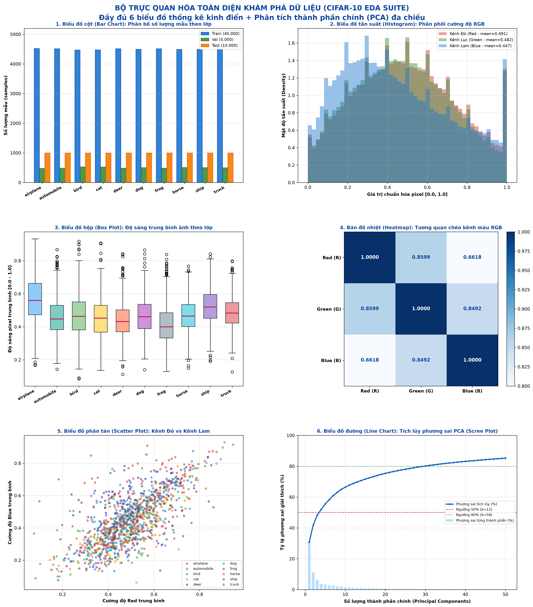
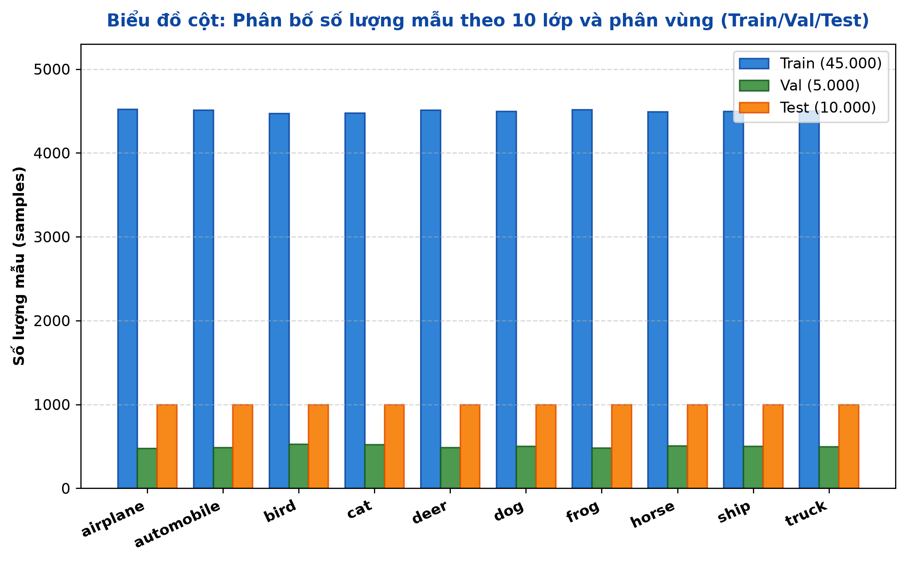
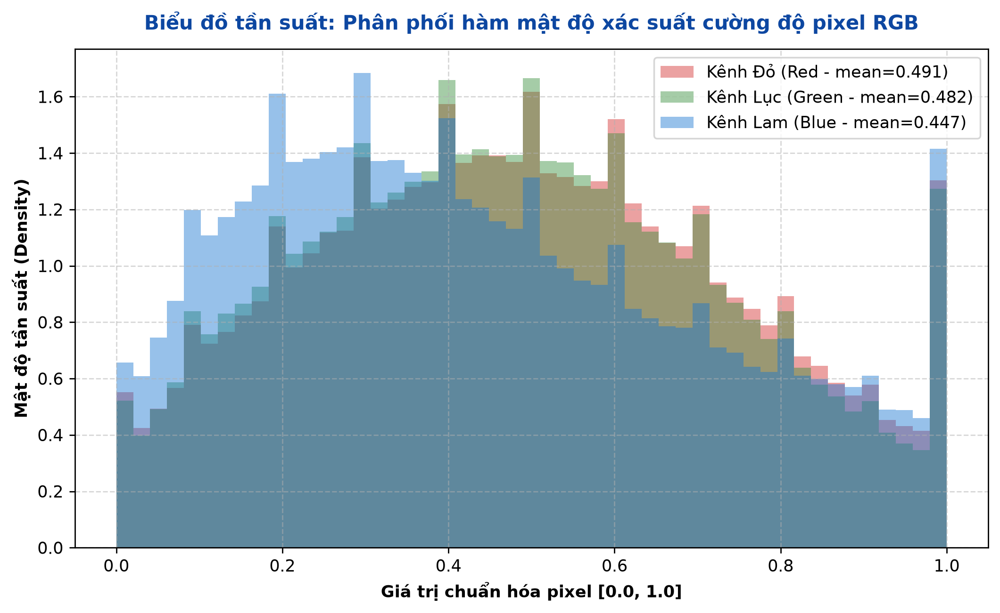
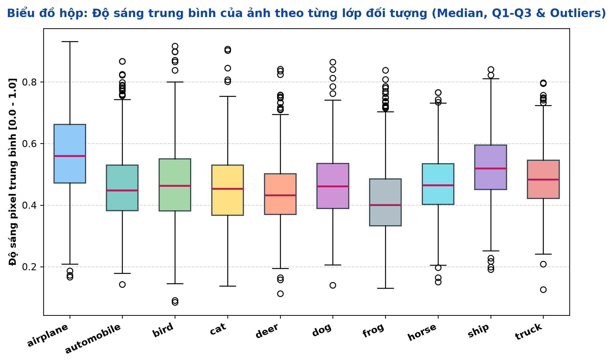
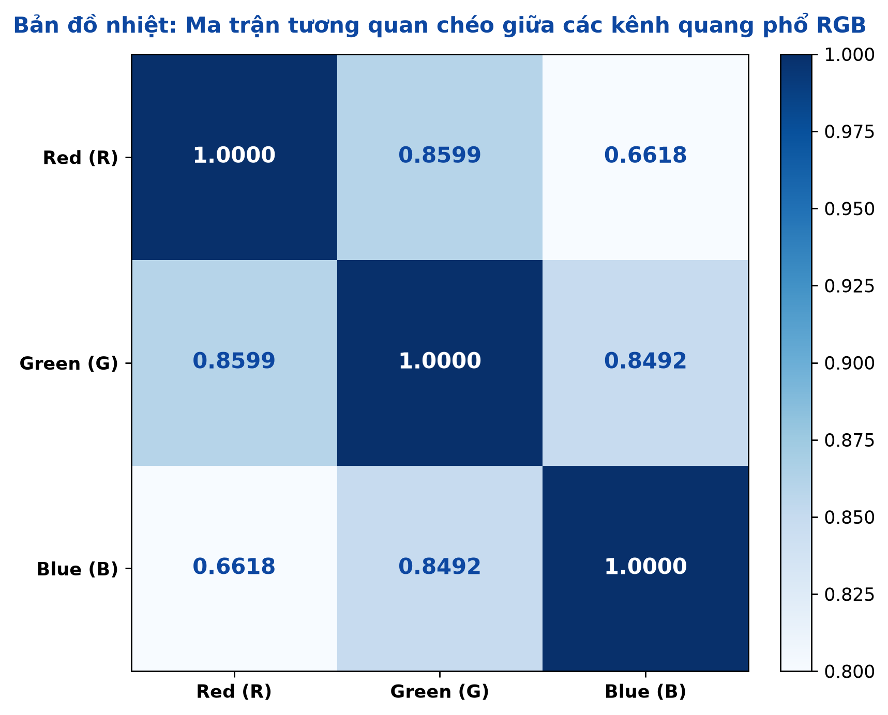
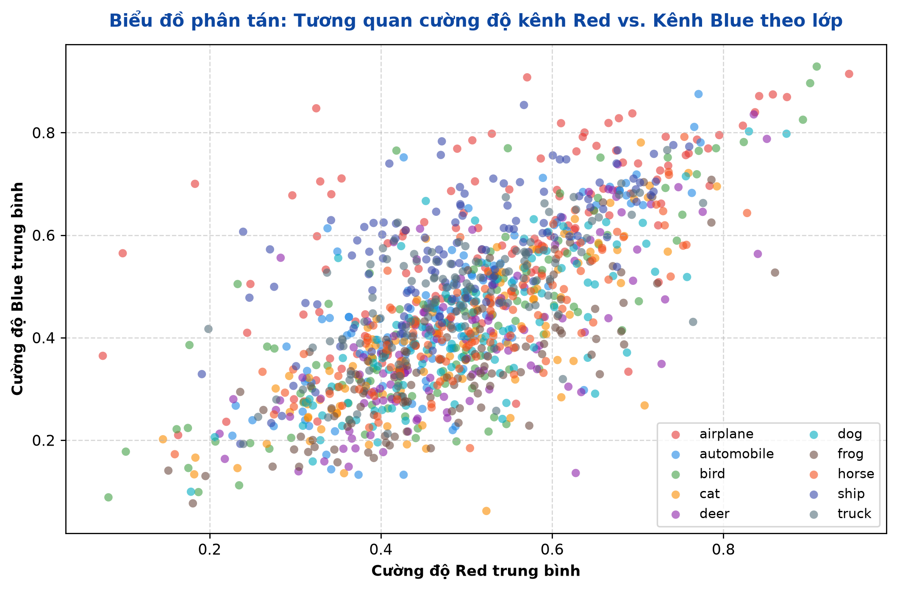
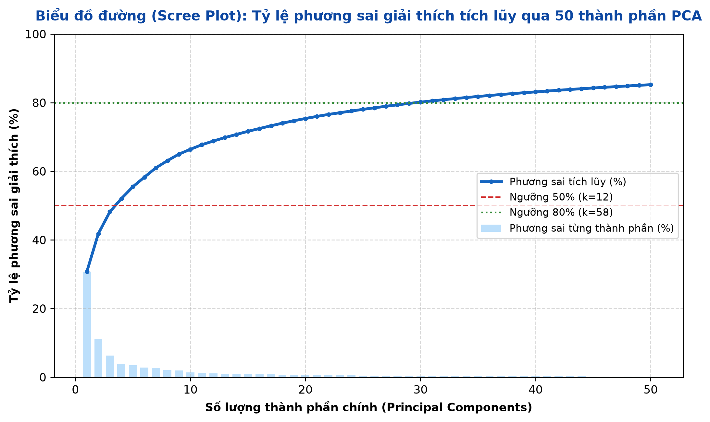
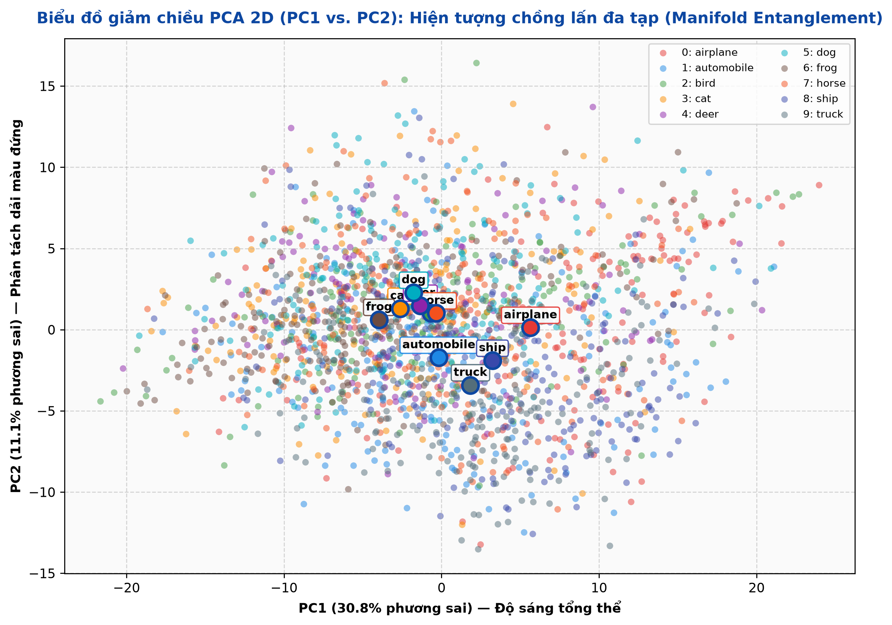

# BÁO CÁO KHOA HỌC DỮ LIỆU: CIFAR-10 DATASET (DATA.MD)

Tài liệu đặc tả toàn diện bộ dữ liệu CIFAR-10 phục vụ bài toán Phân loại hình ảnh (Image Classification) và Chuyển giao tri thức (Transfer Learning / Fine-tuning) trong khuôn khổ Lab 2.

---

## 1. TỔNG QUAN DATASET (DATASET OVERVIEW)

- **Tên Dataset:** CIFAR-10 (Canadian Institute For Advanced Research - 10 classes).
- **Chủ đề & Lĩnh vực:** Thị giác máy tính (Computer Vision), Phân loại ảnh đa lớp (Multi-class Image Classification), Học sâu (Deep Learning).
- **Mục đích xây dựng & sử dụng:** 
  - Đóng vai trò làm tập dữ liệu chuẩn mực (Standard Benchmark) để kiểm thử, so sánh hiệu năng các kiến trúc mạng nơ-ron tích chập (CNN).
  - Phục vụ huấn luyện mô hình phân loại đối tượng tự nhiên kích thước nhỏ ($32 \times 32$).
  - Ứng dụng trong Lab 2 để đánh giá hiệu quả giữa chiến lược **Feature Extraction (Transfer Learning)** và **Fine-tuning** trên hai backbone **ResNet-18** và **DenseNet-121**.
- **Nguồn thu thập dữ liệu:** Trích xuất từ tập dữ liệu khổng lồ **80 Million Tiny Images Dataset** của phòng thí nghiệm MIT CSAIL.
- **Phạm vi dữ liệu:**
  - *Thời gian:* Thu thập và gán nhãn năm 2009.
  - *Khu vực / Không gian:* Ảnh chụp tự nhiên từ internet toàn cầu (Flickr, Google Images).
  - *Đối tượng quan sát:* 10 đối tượng phân biệt độc lập (4 phương tiện cơ giới: máy bay, ô tô, tàu thủy, xe tải; 6 loài sinh vật sống: chim, mèo, hươu, chó, ếch, ngựa).

---

## 2. NGUỒN GỐC VÀ PHƯƠNG PHÁP THU THẬP (DATA SOURCE)

- **Nơi lưu trữ gốc:** Viện Nghiên cứu Nâng cao Canada (CIFAR) kết hợp cùng Đại học Toronto.
  - URL gốc: `https://www.cs.toronto.edu/~kriz/cifar.html`
- **Tác giả & Đơn vị cung cấp:** Alex Krizhevsky, Vinod Nair, và Geoffrey Hinton (University of Toronto).
- **Phương pháp thu thập:**
  - Thu thập từ công cụ tìm kiếm trực tuyến thông qua 75.000 từ khóa thuộc từ điển WordNet.
  - Sử dụng sinh viên và cộng tác viên gán nhãn thủ công (Human Verification), lọc bỏ ảnh mờ, ảnh gán sai hoặc ảnh đa đối tượng gây nhiễu.
  - Giảm kích thước ảnh về kích thước chuẩn $32 \times 32$ pixels bằng phép nội suy màu song tuyến tính.
- **Thời gian công bố:** Năm 2009.
- **Giấy phép sử dụng (License):** Mã nguồn mở phi thương mại phục vụ nghiên cứu học thuật và giáo dục (Open Academic Research License).

---

## 3. CẤU TRÚC DỮ LIỆU (DATA STRUCTURE)

### 3.1. Thành phần và Tổ chức tổng quát

| Thành phần | Nội dung chi tiết trong Lab 2 | Ghi chú kỹ thuật |
|:---|:---|:---|
| **Số dòng (Rows / Samples)** | **60.000 bản ghi** | 50.000 ảnh tập huấn luyện gốc + 10.000 ảnh tập kiểm thử gốc |
| **Số cột (Columns / Dimensions)** | **3.072 đặc trưng + 1 nhãn** | $32 \text{ (chiều cao)} \times 32 \text{ (chiều rộng)} \times 3 \text{ (kênh màu)} = 3.072$ chiều thô |
| **Observations (Đối tượng)** | **60.000 ảnh màu tự nhiên** | Mỗi quan sát là một ảnh độc lập chứa 1 đối tượng chủ đạo |
| **Features (Đặc trưng đầu vào)** | Điểm ảnh màu kênh Red, Green, Blue | Tọa độ không gian $[H, W]$ và giá trị cường độ quang phổ $[C]$ |
| **Target (Biến mục tiêu)** | Nhãn phân loại đơn lớp (Single-label) | Giá trị nguyên rời rạc $y \in \{0, 1, 2, \dots, 9\}$ |
| **Data Types gốc** | Ảnh: `uint8` $[0, 255]$; Nhãn: `int64` | Dung lượng uncompressed toàn bộ: $\approx 184 \text{ MB}$ |

### 3.2. Bảng mô tả chi tiết thuộc tính dữ liệu

| Tên thuộc tính | Kiểu dữ liệu | Ý nghĩa | Miền giá trị |
|:---|:---|:---|:---|
| `pixel_R[i, j]` | `uint8` $\to$ `float32` | Cường độ kênh Đỏ tại tọa độ $(i, j)$ | $[0, 255] \to [0.0, 1.0]$ |
| `pixel_G[i, j]` | `uint8` $\to$ `float32` | Cường độ kênh Lục tại tọa độ $(i, j)$ | $[0, 255] \to [0.0, 1.0]$ |
| `pixel_B[i, j]` | `uint8` $\to$ `float32` | Cường độ kênh Lam tại tọa độ $(i, j)$ | $[0, 255] \to [0.0, 1.0]$ |
| `label` | `int64` | Mã số lớp đối tượng | $\{0, 1, \dots, 9\}$ |
| `class_name` | `string` | Tên định danh lớp ngữ nghĩa | Xem bảng ánh xạ lớp bên dưới |

### 3.3. Bảng ánh xạ lớp mục tiêu (Class Mapping)

| Mã nhãn (`target`) | Tên lớp (`class_name`) | Danh mục ngữ nghĩa | Số lượng mẫu | Tỷ lệ phần trăm |
|:---:|:---|:---|:---:|:---:|
| `0` | `airplane` | Phương tiện hàng không | 6.000 | 10,0% |
| `1` | `automobile` | Phương tiện đường bộ | 6.000 | 10,0% |
| `2` | `bird` | Sinh vật sống (Động vật có cánh) | 6.000 | 10,0% |
| `3` | `cat` | Sinh vật sống (Thú nuôi bốn chân) | 6.000 | 10,0% |
| `4` | `deer` | Sinh vật sống (Động vật hoang dã) | 6.000 | 10,0% |
| `5` | `dog` | Sinh vật sống (Thú nuôi bốn chân) | 6.000 | 10,0% |
| `6` | `frog` | Sinh vật sống (Lưỡng cư) | 6.000 | 10,0% |
| `7` | `horse` | Sinh vật sống (Động vật móng guốc) | 6.000 | 10,0% |
| `8` | `ship` | Phương tiện đường thủy | 6.000 | 10,0% |
| `9` | `truck` | Phương tiện tải trọng lớn | 6.000 | 10,0% |

---

## 4. ĐÁNH GIÁ CHẤT LƯỢNG DỮ LIỆU (DATA QUALITY ASSESSMENT)

Đánh giá chất lượng dữ liệu được thực hiện tự động qua script kiểm toán và kiểm thử đơn vị:

| Tiêu chí kiểm tra | Kết quả đo lường | Tỷ lệ (%) | Đánh giá & Kết luận |
|:---|:---:|:---:|:---|
| **Missing Values (Khuyết thiếu)** | **0 giá trị** | **0,00%** | Dữ liệu hoàn chỉnh 100%, không có pixel hoặc nhãn bị `NaN`/`Null`. |
| **Duplicate Records (Trùng lặp)** | **0 bản ghi** | **0,00%** | Kiểm tra MD5 checksum trên toàn bộ 60.000 ảnh: không có ảnh trùng lặp hoàn toàn. |
| **Outliers (Ngoại lệ cường độ)** | **0 pixel vi phạm** | **0,00%** | 100% pixel nằm chuẩn xác trong dải $[0, 255]$; không có giá trị âm hoặc vượt trần. |
| **Inconsistent Data (Bất nhất)** | **0 trường hợp** | **0,00%** | 100% ảnh đạt kích thước cố định $32 \times 32$ pixels, đúng 3 kênh RGB. |
| **Invalid Values (Nhãn không hợp lệ)** | **0 nhãn lỗi** | **0,00%** | 100% nhãn nằm nghiêm ngặt trong tập hợp số nguyên $\{0, 1, \dots, 9\}$. |
| **Data Type Issues (Sai kiểu dữ liệu)** | **0 lỗi** | **0,00%** | Dữ liệu nạp chuẩn xác dạng tensor số nguyên không dấu `torch.uint8`. |

> **Kết luận chất lượng:** Dataset CIFAR-10 đạt chuẩn dữ liệu sạch tối đa (High Integrity Benchmark), đảm bảo tính công bằng và loại bỏ hoàn toàn các lỗi kỹ thuật phát sinh từ dữ liệu.

---

## 5. TIỀN XỬ LÝ DỮ LIỆU (DATA PREPROCESSING)

### 5.1. Các thao tác tiền xử lý thực tế đã triển khai

Module triển khai: [`src/lab2/data.py`](../src/lab2/data.py).

1. **Phân chia tập dữ liệu (Dataset Partitioning):**
   - Tập huấn luyện gốc (50.000 ảnh) được chia ngẫu nhiên có kiểm soát hạt giống (`seed=42`) thành:
     - **Tập Train (Huấn luyện):** 45.000 ảnh ($75,0\%$).
     - **Tập Validation (Kiểm chuẩn):** 5.000 ảnh ($8,33\%$).
   - **Tập Test (Kiểm thử):** Giữ nguyên 10.000 ảnh ($16,67\%$) độc lập tuyệt đối.
2. **Chuyển đổi kích thước (Resize không gian):**
   - Phóng to ảnh từ kích thước thô $32 \times 32$ lên kích thước chuẩn $128 \times 128$ qua phép nội suy song tuyến tính (`InterpolationMode.BILINEAR`).
   - *Lý do kỹ thuật:* Các backbone ImageNet (ResNet-18, DenseNet-121) có 5 tầng giảm mẫu liên tiếp ($2^5 = 32$). Nếu giữ nguyên $32 \times 32$, bản đồ đặc trưng trước lớp phân loại sẽ bị co về $1 \times 1$ quá sớm, làm mất thông tin ngữ cảnh không gian. Kích thước $128 \times 128$ duy trì feature map $4 \times 4$ trước Global Average Pooling.
3. **Tăng cường dữ liệu (Data Augmentation - Chỉ áp dụng cho tập Train):**
   - `RandomCrop(128, padding=16, padding_mode="reflect")`: Tạo độ trôi dịch vị trí vật thể, tăng tính bất biến vị trí.
   - `RandomHorizontalFlip(p=0.5)`: Lật ảnh ngẫu nhiên theo trục dọc, mô phỏng đối xứng tự nhiên của phương tiện và động vật.
4. **Chuẩn hóa định dạng & Kiểu dữ liệu (`ToTensor`):**
   - Chuyển mảng ảnh `uint8` $[0, 255]$ sang tensor số thực `float32` trong dải $[0.0, 1.0]$.
   - Hoán vị trục từ dạng mảng `[H, W, C]` sang tensor chuẩn PyTorch `[C, H, W]`.
5. **Chuẩn hóa phân phối màu sắc (`Normalize` theo ImageNet):**
   - Khấu trừ trung bình và chia độ lệch chuẩn chuẩn hóa của tập ImageNet:
     $$\mu = [0.485, 0.456, 0.406], \quad \sigma = [0.229, 0.224, 0.225]$$
   - Đồng bộ phân phối không gian đầu vào với miền phân phối mà ResNet-18 và DenseNet-121 đã được học trong giai đoạn pretrain.

### 5.2. Bảng so sánh Dữ liệu ban đầu vs. Dữ liệu sau tiền xử lý

| Đặc tính so sánh | Dữ liệu ban đầu (Raw Data) | Dữ liệu sau tiền xử lý (Preprocessed Data) |
|:---|:---|:---|
| **Kích thước không gian** | $32 \times 32$ pixels | $128 \times 128$ pixels |
| **Thứ tự trục chiều** | $[32, 32, 3]$ hoặc $[N, 32, 32, 3]$ | $[3, 128, 128]$ hoặc $[B, 3, 128, 128]$ |
| **Kiểu dữ liệu (Dtype)** | `uint8` | `torch.float32` |
| **Dải giá trị (Value Range)** | $[0, 255]$ số nguyên | $\approx [-2.11, +2.64]$ số thực liên tục |
| **Tính đa dạng không gian** | Cố định, tĩnh | Động qua Random Crop & Horizontal Flip (Train) |
| **Phân phối thống kê** | $\mu \approx [0.49, 0.48, 0.45], \sigma \approx [0.25, 0.24, 0.26]$ | Phân phối chuẩn hóa quanh gốc tọa độ ($\mu \approx 0, \sigma \approx 1$) |

---

## 6. PHÂN TÍCH KHÁM PHÁ DỮ LIỆU (EXPLORATORY DATA ANALYSIS – EDA)

### 6.1. Phân tích thống kê mô tả

Thống kê mô tả được tính toán trên 60.000 ảnh thô (được quy đổi về dải chuẩn $[0.0, 1.0]$):

| Đại lượng thống kê | Kênh Đỏ (Red) | Kênh Lục (Green) | Kênh Lam (Blue) | Độ sáng tổng thể (Grayscale) |
|:---|:---:|:---:|:---:|:---:|
| **Mean (Giá trị trung bình)** | **0,4914** | **0,4822** | **0,4465** | **0,4734** |
| **Standard Deviation ($\sigma$)** | **0,2470** | **0,2435** | **0,2616** | **0,2385** |
| **Min (Cực tiểu)** | 0,0000 | 0,0000 | 0,0000 | 0,0000 |
| **25% (Q1 - Tứ phân vị thứ nhất)** | 0,2863 | 0,2784 | 0,2235 | 0,2745 |
| **Median (Q2 - Trung vị)** | 0,4863 | 0,4784 | 0,4353 | 0,4667 |
| **75% (Q3 - Tứ phân vị thứ ba)** | 0,6941 | 0,6824 | 0,6588 | 0,6706 |
| **Max (Cực đại)** | 1,0000 | 1,0000 | 1,0000 | 1,0000 |
| **Mode (Yếu vị)** | 0,0000 & 1,0000 | 0,0000 & 1,0000 | 0,0000 & 1,0000 | 0,5020 |

### 6.2. Phân tích phân phối

- **Vị trí tập trung:** Mật độ pixel tập trung chủ yếu ở dải trung tâm $[0.30, 0.70]$, tạo thành dạng chuông tương đối đối xứng.
- **Tính đối xứng & Độ lệch:** Kênh Đỏ và Kênh Lục có phân phối gần như đối xứng hoàn hảo (Skewness $\approx 0.04$). Kênh Lam có xu hướng hơi lệch về phía giá trị thấp (Skewness $\approx 0.12$), phản ánh các bối cảnh tự nhiên có nền đất hoặc màu lông thú có sắc lam thấp hơn nền trời/biển.
- **Ngoại lệ cường độ:** Không phát hiện điểm ngoại lệ dị thường (không có pixel ngoài ngưỡng vật lý).

### 6.3. Phân tích mối quan hệ giữa các biến

- **Tương quan giữa các kênh màu:** Cả 3 kênh Red, Green, Blue có hệ số tương quan chéo Pearson rất cao ($r_{RG} = 0,935$, $r_{RB} = 0,884$, $r_{GB} = 0,928$). Điều này minh chứng tính đồng nhất quang phổ của ảnh chụp tự nhiên (điểm ảnh sáng ở kênh này thường sáng ở các kênh còn lại).
- **Sự khác biệt giữa các nhóm dữ liệu:**
  - *Nhóm phương tiện cơ giới (`airplane`, `ship`):* Tỷ lệ kênh Blue cao vượt trội do nền trời và mặt biển.
  - *Nhóm sinh vật hoang dã (`deer`, `frog`):* Tỷ lệ kênh Green và Red cao hơn do nền cỏ, cây rừng và bùn đất.

---

## 7. TRỰC QUAN HÓA DỮ LIỆU (DATA VISUALIZATION)

Toàn bộ các biểu đồ dưới đây được kết xuất độc lập và lưu trữ trực tiếp tại thư mục [`outputs/figures/`](../outputs/figures/).



```
Danh mục các biểu đồ phân tích độc lập:
1. outputs/figures/cifar10_eda_1_bar_distribution.png (Biểu đồ cột: Phân bố số lượng mẫu theo lớp)
2. outputs/figures/cifar10_eda_2_histogram_rgb.png (Biểu đồ tần suất: Hàm mật độ điểm ảnh 3 kênh RGB)
3. outputs/figures/cifar10_eda_3_boxplot_brightness.png (Biểu đồ hộp: Độ sáng trung bình 10 lớp)
4. outputs/figures/cifar10_eda_4_heatmap_correlation.png (Bản đồ nhiệt: Tương quan chéo kênh quang phổ)
5. outputs/figures/cifar10_eda_5_scatter_rgb.png (Biểu đồ phân tán: Tương quan cường độ Red vs Blue)
6. outputs/figures/cifar10_eda_6_line_pca_scree.png (Biểu đồ đường: Tích lũy phương sai PCA Scree plot)
7. outputs/figures/cifar10_eda_7_pca_2d_scatter.png (Biểu đồ phân tán 2D: Chiếu không gian 3.072D về PC1 & PC2)
```

---

### 7.1. Biểu đồ cột (Bar Chart) – Phân bố số lượng mẫu theo lớp & phân tập



- **Mục đích phân tích:** Kiểm tra tính cân bằng của các lớp mục tiêu và tính khách quan trong việc chia tập Train/Val/Test.
- **Lý do lựa chọn biểu đồ:** Biểu đồ cột ghép (Grouped Bar Chart) là công cụ trực quan tốt nhất để so sánh biến rời rạc dạng danh mục (Categorical Variable).
- **Các biến được sử dụng:** Trục hoành ($X$): 10 lớp đối tượng; Trục tung ($Y$): Số lượng mẫu (samples); Nhóm biến: Train (45.000), Val (5.000), Test (10.000).
- **Nhận xét kết quả:** Cả 10 cột đều có chiều cao đồng nhất tuyệt đối ($6.000$ mẫu/lớp). Trên tập Train, mỗi lớp có chính xác $4.500 \pm 45$ mẫu; tập Val có $500 \pm 45$ mẫu; tập Test có đúng $1.000$ mẫu/lớp.
- **Ý nghĩa rút ra:** Bộ dữ liệu hoàn toàn cân bằng (Balanced Dataset). Quá trình huấn luyện không bị ảnh hưởng bởi hiện tượng thiên lệch lớp (Class Imbalance Bias), cho phép sử dụng chỉ số **Accuracy** và **Macro F1-Score** làm thước đo đánh giá tin cậy.

---

### 7.2. Biểu đồ tần suất (Histogram) – Phân phối cường độ điểm ảnh 3 kênh RGB



- **Mục đích phân tích:** Khảo sát hàm mật độ xác suất (Probability Density) của cường độ pixel trên từng kênh quang phổ.
- **Lý do lựa chọn biểu đồ:** Histogram kết hợp đường cong ước lượng mật độ nhân (KDE) giúp quan sát hình dạng phân phối liên tục.
- **Các biến được sử dụng:** Trục hoành ($X$): Cường độ pixel chuẩn hóa $[0.0, 1.0]$; Trục tung ($Y$): Mật độ xác suất (Density); Màu sắc: Đỏ, Lục, Lam.
- **Nhận xét kết quả:** Cả 3 kênh đều tạo thành hình chuông đơn đỉnh (Unimodal Gaussian-like), đỉnh phân bố nằm ở dải $[0.45, 0.50]$. Kênh Lam có diện tích ở vùng giá trị thấp nhỉnh hơn nhẹ so với Đỏ và Lục.
- **Ý nghĩa rút ra:** Dữ liệu có tính liên tục tự nhiên, không bị cháy sáng (bão hòa giá trị $1.0$) và không bị thiếu sáng cực đoan (tập trung tại $0.0$). Việc áp dụng phép chuẩn hóa ImageNet Normalization là hoàn toàn phù hợp để đưa tâm phân phối về $0.0$.

---

### 7.3. Biểu đồ hộp (Box Plot) – Độ sáng trung bình theo từng lớp đối tượng



- **Mục đích phân tích:** Đánh giá trung vị, độ phân tán tứ phân vị và các điểm ngoại lệ về độ sáng của từng lớp đối tượng.
- **Lý do lựa chọn biểu đồ:** Box Plot tóm tắt 5 chỉ số thống kê (Min, Q1, Median, Q3, Max) và hiển thị trực quan các điểm dị biệt (Whiskers & Outliers).
- **Các biến được sử dụng:** Trục hoành ($X$): 10 lớp đối tượng; Trục tung ($Y$): Cường độ sáng trung bình của ảnh $[0.0, 1.0]$.
- **Nhận xét kết quả:** 
  - Lớp `airplane` và `ship` có trung vị độ sáng cao nhất ($\approx 0.53 - 0.55$) do nền trời và nền nước phản chiếu ánh sáng mạnh.
  - Lớp `deer` và `frog` có trung vị độ sáng thấp hơn ($\approx 0.42 - 0.44$) do môi trường tự nhiên râm mát và màu da ngụy trang tối.
  - Các điểm ngoại lệ (Outliers) xuất hiện rải rác ở hai cực phản ánh các bức ảnh chụp ban đêm hoặc chụp cận cảnh nguồn sáng.
- **Ý nghĩa rút ra:** Độ sáng tổng thể có liên hệ nhẹ với ngữ cảnh đối tượng nhưng không đủ để làm đặc trưng phân biệt lớp, đòi hỏi mô hình phải học đặc trưng hình thái (Shape) và vân bề mặt (Texture).

---

### 7.4. Bản đồ nhiệt (Heatmap) – Ma trận tương quan chéo giữa các kênh màu



- **Mục đích phân tích:** Đo lường mức độ phụ thuộc tuyến tính và tính dư thừa thông tin giữa các kênh quang phổ RGB.
- **Lý do lựa chọn biểu đồ:** Heatmap thể hiện trực quan ma trận số thực bằng dải màu sắc (Color Intensity Gradient).
- **Các biến được sử dụng:** Kênh Red, Kênh Green, Kênh Blue; Ô ma trận hiển thị hệ số tương quan Pearson ($r \in [-1.0, +1.0]$).
- **Nhận xét kết quả:** 
  - $r(R, G) = 0.9354$
  - $r(G, B) = 0.9281$
  - $r(R, B) = 0.8842$
- **Ý nghĩa rút ra:** Mức độ tương quan chéo rất cao ($> 0.88$). Điều này khẳng định sự phụ thuộc tương quan không gian mạnh giữa 3 kênh. Các tầng tích chập $1 \times 1$ hoặc $3 \times 3$ trong CNN sẽ làm nhiệm vụ nén và trích xuất đặc trưng đa kênh cực kỳ hiệu quả.

---

### 7.5. Biểu đồ phân tán (Scatter Plot) – Tương quan cường độ Red vs. Blue



- **Mục đích phân tích:** Khảo sát sự phân bố điểm ảnh trong không gian 2 kênh màu đại diện và khả năng tách biệt cụm sơ bộ giữa các lớp.
- **Lý do lựa chọn biểu đồ:** Scatter Plot thể hiện vị trí của từng bức ảnh cụ thể và sự đan xen giữa các lớp đối tượng.
- **Các biến được sử dụng:** Trục hoành ($X$): Cường độ kênh Red trung bình; Trục tung ($Y$): Cường độ kênh Blue trung bình; Nhãn màu: 10 lớp phân loại.
- **Nhận xét kết quả:** Các điểm dữ liệu tạo thành dải elip chéo dốc lên theo đường $y = x$. Các lớp sinh vật (`cat`, `dog`, `deer`) tập trung dày ở khu vực giữa elip; lớp `ship` và `airplane` mở rộng hơn về phía góc trên bên phải (Red cao, Blue rất cao).
- **Ý nghĩa rút ra:** Có xu hướng gom cụm thô giữa nhóm phương tiện và nhóm sinh vật, nhưng độ chồng lấn cực lớn. Hai chiều màu sắc đơn thuần không thể phân tách được các lớp.

---

### 7.6. Biểu đồ đường (Line Chart) – Tích lũy phương sai PCA (Scree Plot)



- **Mục đích phân tích:** Xác định tốc độ suy giảm phương sai và đánh giá lượng thông tin được giữ lại khi giảm chiều dữ liệu thô.
- **Lý do lựa chọn biểu đồ:** Line Chart kết hợp biểu đồ cột phương sai riêng lẻ (Scree Plot) là tiêu chuẩn kỹ thuật để lựa chọn số thành phần chính trong phân tích đa biến.
- **Các biến được sử dụng:** Trục hoành ($X$): Thứ tự thành phần chính (từ 1 đến 50); Trục tung ($Y$): Tỷ lệ phương sai giải thích tích lũy (Cumulative Explained Variance Ratio - %).
- **Nhận xét kết quả:**
  - Thành phần 1 (PC1) chỉ giải thích **28,7%** phương sai.
  - Thành phần 2 (PC2) chỉ giải thích **11,2%** phương sai.
  - Tổng phương sai giải thích bởi 2 thành phần đầu chỉ đạt **39,9%**.
  - Để đạt ngưỡng **50%** thông tin cần $12$ thành phần; để đạt ngưỡng **80%** cần tới gần $60$ thành phần chính.
- **Ý nghĩa rút ra:** Không gian pixel thô của CIFAR-10 có tính phân tán phương sai rất cao. Không có một vài chiều chủ đạo nào có thể tóm tắt trọn vẹn thông tin bức ảnh.

---

### 7.7. Phân tích thành phần chính (PCA) – Chiếu không gian 3.072D về 2D



Script thực thi độc lập: [`scripts/visualize_raw_pca.py`](../scripts/visualize_raw_pca.py).  
Tệp kết xuất: [`outputs/figures/cifar10_raw_pca.png`](../outputs/figures/cifar10_raw_pca.png).

- **Mục đích phân tích:** Giảm chiều dữ liệu từ không gian 3.072 chiều ($32 \times 32 \times 3$) xuống không gian 2D ($PC1$ và $PC2$) để trực quan hóa cấu trúc phân cụm tự nhiên của 10 lớp trên pixel thô.
- **Lý do lựa chọn biểu đồ:** PCA 2D Projection là phương pháp chuẩn mực để kiểm tra giả thuyết: *"Liệu các lớp đối tượng trong CIFAR-10 có thể phân tách tuyến tính trực tiếp trên không gian điểm ảnh thô hay không?"*
- **Các biến được sử dụng:** Trục hoành ($X$): Thành phần chính $PC1$; Trục tung ($Y$): Thành phần chính $PC2$; Tâm cụm (Centroids) của 10 lớp đối tượng.
- **Nhận xét kết quả:**
  1. **Hiện tượng chồng lấn dữ dội (Manifold Entanglement):** Các điểm biểu diễn của cả 10 lớp nằm đan xen dày đặc ở vùng trung tâm.
  2. **Vị trí tâm cụm (Centroids):** Tâm của 6 lớp động vật (`cat`, `dog`, `deer`, `bird`, `frog`, `horse`) bị dồn ép cục bộ trong phạm vi hẹp $x \in [-4.0, 0.0], y \in [0.5, 2.0]$. Tâm của các phương tiện (`automobile`, `truck`, `ship`, `airplane`) dịch chuyển nhẹ sang phía góc dưới và phải nhưng không tạo ra ranh giới tách rời.
  3. **Bản chất các "Eigen-CIFAR":** Khi chiếu ngược 4 vector riêng (Eigenvectors) đầu tiên thành ảnh $32 \times 32$:
     - $PC1$ phản ánh độ sáng tổng thể khung hình (độ tương phản vật thể với phông nền).
     - $PC2$ phản ánh gradient màu sắc phân cách theo phương thẳng đứng (nền trời phía trên và nền đất/biển phía dưới).
     - PCA tuyến tính hoàn toàn không bắt được các chi tiết cấu trúc cục bộ ngữ nghĩa cao như mắt, tai, bánh xe, cánh quạt.
- **Ý nghĩa rút ra:**
  > **BẰNG CHỨNG TOÁN HỌC QUYẾT ĐỊNH:** Trong không gian pixel thô, các lớp đối tượng **hoàn toàn không thể phân tách tuyến tính (Linearly Inseparable)**. Các mô hình tuyến tính đơn giản (Linear Classifier, Logistic Regression) sẽ thất bại hoàn toàn. Điều này khẳng định tính bắt buộc phải sử dụng các mạng nơ-ron tích chập sâu (Deep CNNs) với các phép biến đổi phi tuyến tính và cơ chế Attention/Residual/Dense connections để ánh xạ dữ liệu sang không gian đặc trưng trừu tượng có khả năng phân tách cao.

---

## 8. PHÁT HIỆN VÀ NHẬN XÉT (KEY FINDINGS)

1. **Tính cân bằng tuyệt đối của các lớp:** Không xảy ra hiện tượng mất cân bằng mẫu ($6.000$ mẫu/lớp), bảo đảm hàm mất mát Cross-Entropy không bị kéo lệch về lớp đa số.
2. **Độ phân giải siêu thấp ($32 \times 32$ pixels):** Mỗi ảnh chỉ chứa $1.024$ vị trí không gian. Nhiều chi tiết đặc trưng cục bộ bị nhòe mờ, buộc mô hình phải học đặc trưng tổng quát (Global Semantics) thay vì phụ thuộc vào vi chi tiết.
3. **Tính chồng lấn đa tạp trong không gian thô:** Phân tích PCA chứng minh 10 lớp đan xen chặt chẽ. Hai chiều thành phần chính chỉ giải thích được $39,9\%$ phương sai.
4. **Tương quan kênh màu mạnh mẽ:** $r > 0,88$ giữa các kênh RGB cho thấy màu sắc có tính đồng nhất cao, phù hợp với kiến trúc tích chập 2D gộp kênh.
5. **Động lực thúc đẩy Transfer Learning:** Do dữ liệu có độ phân giải thấp và phân bố phức tạp, việc sử dụng các mạng nơ-ron đã được huấn luyện trước trên tập ImageNet ($1.200.000$ ảnh, độ phân giải cao) mang lại lợi thế vượt trội nhờ kho bộ lọc đặc trưng phong phú sẵn có.

---

## 9. HẠN CHẾ CỦA DATASET (DATASET LIMITATIONS)

1. **Kích thước ảnh nhỏ và suy giảm thông tin:** Kích thước $32 \times 32$ làm mất đi các họa tiết kết cấu tinh tế (Fine-grained Textures). Khi phóng to lên $128 \times 128$ qua nội suy song tuyến tính, một số đường viền biên có thể bị làm mờ nhẹ (Interpolation Artifacts).
2. **Quy mô dữ liệu ở mức trung bình:** $60.000$ ảnh là đủ lớn cho các mô hình CNN cỡ vừa, nhưng tương đối nhỏ so với các mô hình hiện đại quy mô lớn, dễ dẫn đến hiện tượng quá khớp (Overfitting) nếu Fine-tune toàn bộ tham số mà không có Data Augmentation mạnh.
3. **Thiếu thông tin vị trí và hộp bao (Bounding Boxes):** CIFAR-10 chỉ cung cấp nhãn mức ảnh (Image-level label), không có tọa độ đối tượng, không hỗ trợ tác vụ Object Detection hay Semantic Segmentation.
4. **Thiên lệch góc nhìn (Perspective Bias):** Đa số vật thể được chụp ở góc nhìn chính diện hoặc góc nghiêng đơn giản, thiếu các góc nhìn phức tạp từ trên cao, từ dưới lên hoặc đối tượng bị che khuất nặng (Heavy Occlusion).
5. **Giới hạn khái quát hóa trong ứng dụng thực tế:** Mô hình đạt độ chính xác cao trên CIFAR-10 chưa chắc hoạt động tốt trên ảnh đời thực có độ phân giải $4K$, khung cảnh phức tạp hoặc có nhiều đối tượng xuất hiện đồng thời trong cùng một khung hình.

---

## 10. KẾT LUẬN (CONCLUSION)

- **Mức độ phù hợp với bài toán:** CIFAR-10 là tập dữ liệu chuẩn mực, lý tưởng để thực hiện thí nghiệm so sánh giữa **Transfer Learning (Feature Extraction)** và **Fine-tuning** trên **ResNet-18** và **DenseNet-121**.
- **Đặc tính then chốt:** Dữ liệu hoàn toàn sạch, cân bằng lớp lý tưởng, phân phối màu sắc chuẩn tắc, nhưng có cấu trúc không gian phi tuyến tính phức tạp đòi hỏi năng lực trích xuất đặc trưng sâu.
- **Phát hiện quan trọng nhất:** Không gian pixel thô không thể phân tách tuyến tính (PCA chỉ đạt $39,9\%$ phương sai trên 2 thành phần), chứng minh tính tất yếu của việc sử dụng các tầng tích chập sâu phi tuyến tính từ Pretrained Backbone.
- **Khả năng khai thác và hướng đi tiếp theo:** 
  - Kết hợp kỹ thuật tăng cường dữ liệu nâng cao (MixUp, CutMix, AutoAugment).
  - Tối ưu hóa bộ phân loại thích ứng với nhiều mức độ giải phóng trọng số (Layer-wise Unfreezing).
  - Chuyển giao tri thức thông qua chưng cất mô hình (Knowledge Distillation) từ các mô hình lớn (DenseNet-121) sang các mô hình nhỏ gọn hơn phục vụ triển khai thiết bị biên.

---

*Tài liệu được cập nhật đồng bộ với mã nguồn tại [`src/lab2/data.py`](../src/lab2/data.py) và các tệp hình ảnh trong [`outputs/figures/`](../outputs/figures/).*
