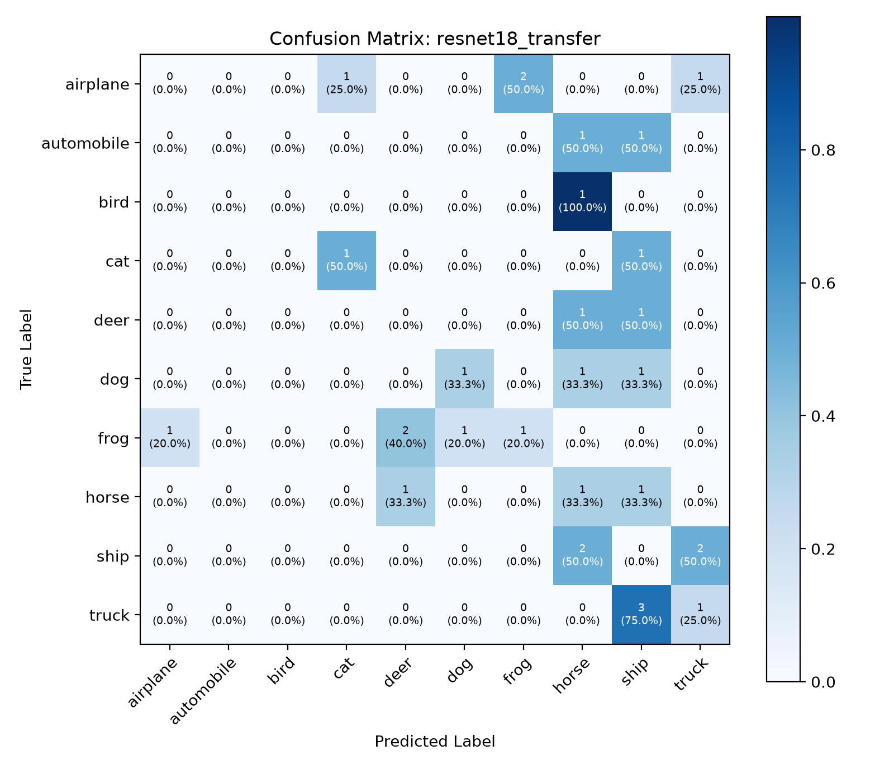
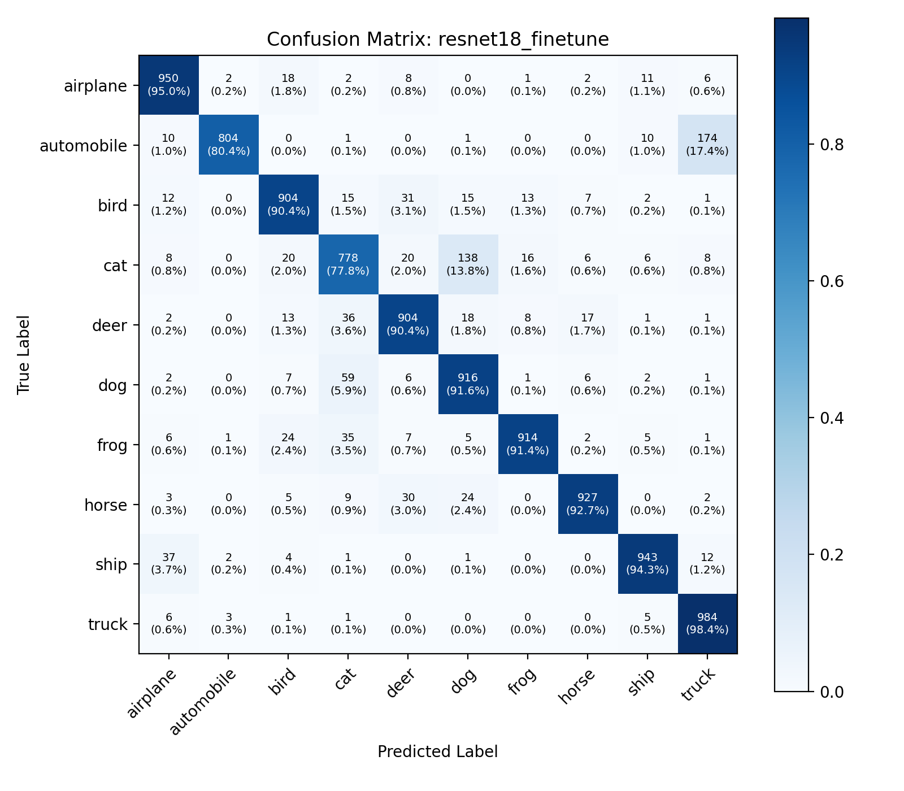
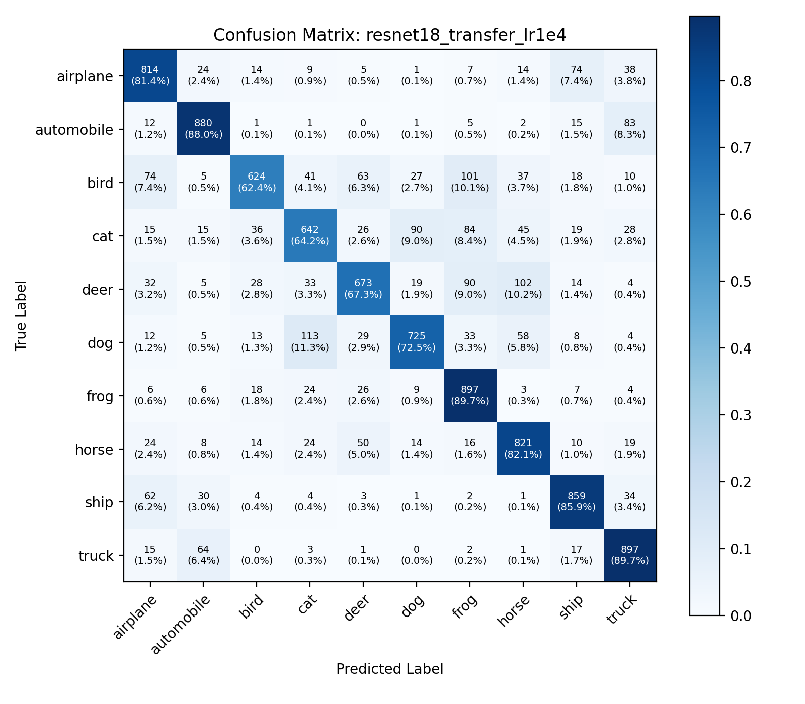
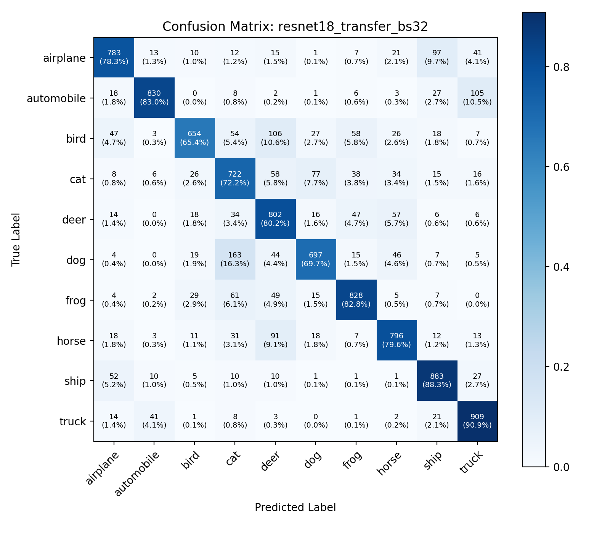

# BÁO CÁO KHOA HỌC: CHUYỂN GIAO TRI THỨC VÀ TINH CHỈNH MÔ HÌNH HỌC SÂU TRÊN BỘ DỮ LIỆU CIFAR-10

**Dự án:** Laboratory 2 — Deep Learning Scientific Report  
**Tác giả:** Nhóm 1  
**Mã nguồn:** [`src/lab2/`](../src/lab2/) | **Báo cáo mở rộng:** [`outputs/Lab2_Report.html`](../outputs/Lab2_Report.html)  
**Tiêu chuẩn:** Academic – Concise – Structured – Reproducible – Evidence-based

---

## 1. ABSTRACT

Nghiên cứu này khảo sát hiệu quả chuyển giao tri thức (Transfer Learning) từ tập dữ liệu quy mô lớn ImageNet-1K sang bài toán phân loại ảnh màu 10 lớp CIFAR-10 ($32 \times 32$ pixels). Hai kiến trúc mạng nơ-ron tích chập kinh điển đại diện cho hai cơ chế lan truyền đặc trưng khác nhau được đánh giá đối chứng: ResNet-18 (Residual Addition) và DenseNet-121 (Dense Concatenation). Hai chiến lược huấn luyện được triển khai: (1) Trích xuất đặc trưng (Feature Extraction - đóng băng toàn bộ backbone) và (2) Tinh chỉnh chọn lọc (Fine-tuning - mở khóa khối sâu nhất kết hợp tốc độ học phân tầng Differential Learning Rates). Kết quả thực nghiệm khẳng định Fine-tuning vượt trội hoàn toàn Feature Extraction, nâng độ chính xác kiểm thử (Test Accuracy) từ 77.98% lên 90.24% đối với ResNet-18 và từ 81.34% lên 90.65% đối với DenseNet-121. Mặc dù DenseNet-121 đạt độ chính xác cao nhất và tiết kiệm 37.7% tổng tham số so với ResNet-18, ResNet-18 lại ưu việt hơn về thông lượng huấn luyện và tốc độ suy luận trên môi trường CPU.

---

## 2. INTRODUCTION

### 2.1. Bối cảnh nghiên cứu
Huấn luyện mạng nơ-ron tích chập sâu (Deep CNN) từ đầu (from scratch) trên các tập dữ liệu có kích thước nhỏ và tài nguyên tính toán giới hạn thường đối mặt với hai trở ngại lớn: hiện tượng quá khớp (Overfitting) do không gian tham số quá lớn và chi phí tính toán gradient khổng lồ.

### 2.2. Mục tiêu nghiên cứu
1. Chuyển giao tri thức thị giác tổng quát từ mô hình tiền huấn luyện trên ImageNet-1K sang miền đích CIFAR-10.
2. So sánh định lượng giữa cơ chế cộng tắt (Residual Addition) của ResNet-18 và cơ chế ghép kênh (Feature Concatenation) của DenseNet-121.
3. Đánh giá đối chứng hai chiến lược thích ứng: Feature Extraction (đóng băng trọng số) và Fine-tuning (mở khóa cục bộ với Differential Learning Rates).
4. Phân tích ảnh hưởng của siêu tham số tốc độ học (Learning Rate) và kích thước lô (Batch Size).

### 2.3. Vấn đề giải quyết
Ánh xạ dữ liệu thô độ phân giải thấp ($32 \times 32$) sang không gian đặc trưng trừu tượng có khả năng phân tách tuyến tính, khắc phục hiện tượng chồng lấn đa tạp (Manifold Entanglement) mà các mô hình tuyến tính đơn giản không giải quyết được.

---

## 3. RELATED WORK

- **Mô hình Pretrained trên ImageNet:** Krizhevsky et al. (2012) mở ra kỷ nguyên học sâu với AlexNet. ImageNet Large Scale Visual Recognition Challenge (ILSVRC) cung cấp nền tảng tri thức thị giác đa dạng với 1,28 triệu ảnh tự nhiên trên 1.000 danh mục.
- **Kiến trúc mạng dư (Residual Networks):** He et al. (2016) giải quyết vấn đề suy biến gradient (Degradation Problem) bằng cơ chế kết nối tắt (Identity Shortcut Connections), cho phép huấn luyện các mạng tích chập sâu hàng trăm tầng.
- **Kiến trúc mạng kết nối dày đặc (DenseNet):** Huang et al. (2017) tối đa hóa dòng thông tin và gradient thông qua việc nối trực tiếp đặc trưng từ mọi tầng trước vào mọi tầng sau, giảm thiểu trùng lặp tham số.
- **Chuyển giao tri thức trong thị giác máy tính:** Yosinski et al. (2014) chứng minh các tầng tích chập đầu trích xuất đặc trưng tổng quát (Gabor filters, viền, góc), trong khi các tầng sâu đại diện cho ngữ nghĩa đặc thù của miền nguồn. Do đó, việc tinh chỉnh các tầng sâu là chiến lược tối ưu khi miền đích có sự khác biệt về phân phối.

---

## 4. THEORETICAL BACKGROUND

### 4.1. Cơ chế cộng tắt của ResNet
Khối thặng dư cơ bản (Basic Residual Block) ánh xạ đầu vào $x$ sang đầu ra $y$ theo công thức:
$$y = \mathcal{F}(x, \{W_i\}) + x$$
Trong đó $\mathcal{F}$ biểu diễn hàm biến đổi phi tuyến gồm 2 tầng tích chập $3 \times 3$, chuẩn hóa Batch Normalization và hàm kích hoạt ReLU. Gradient lan truyền ngược được phân tách thành:
$$\frac{\partial \mathcal{E}}{\partial x} = \frac{\partial \mathcal{E}}{\partial y} \left( \frac{\partial \mathcal{F}}{\partial x} + 1 \right)$$
Hạng tử $+1$ bảo đảm gradient luôn được truyền thẳng về các tầng trước mà không bị triệt tiêu theo cấp số nhân.

### 4.2. Cơ chế ghép nối kênh đặc trưng của DenseNet
Mỗi tầng $\ell$ trong Dense Block nhận toàn bộ bản đồ đặc trưng của các tầng trước làm đầu vào qua phép nối tensor dọc theo trục kênh:
$$x_\ell = H_\ell([x_0, x_1, \dots, x_{\ell-1}])$$
Với tốc độ tăng trưởng (Growth Rate) $k = 32$, mỗi tầng chỉ sinh thêm $k$ kênh đặc trưng, giúp hạn chế sự bùng nổ tham số và tái sử dụng triệt để đặc trưng đã trích xuất.

### 4.3. Hàm mất mát và Tối ưu hóa
- **Hàm mất mát Cross-Entropy Đa lớp:**
$$\mathcal{L}_{CE} = -\frac{1}{N} \sum_{i=1}^N \sum_{c=1}^{C} y_{i, c} \log(\hat{p}_{i, c})$$
với $\hat{p}_{i, c} = \frac{e^{z_{i, c}}}{\sum_{j=1}^C e^{z_{i, j}}}$.
- **Tối ưu hóa Adam (Adaptive Moment Estimation):**
$$m_{t+1} = \beta_1 m_t + (1 - \beta_1) g_t, \quad v_{t+1} = \beta_2 v_t + (1 - \beta_2) g_t^2$$
$$\hat{m}_{t+1} = \frac{m_{t+1}}{1 - \beta_1^{t+1}}, \quad \hat{v}_{t+1} = \frac{v_{t+1}}{1 - \beta_2^{t+1}}, \quad \theta_{t+1} = \theta_t - \frac{\eta}{\sqrt{\hat{v}_{t+1}} + \epsilon} \hat{m}_{t+1}$$
với $\beta_1 = 0.9, \beta_2 = 0.999$, kết hợp hệ số Weight Decay $10^{-4}$. Mô hình cũng hỗ trợ bộ tối ưu hóa SGD kết hợp Momentum ($0.9$).
- **Tốc độ học phân tầng (Differential Learning Rates):**
$$\eta_{\text{backbone}} = 0.1 \times \eta_{\text{head}}$$
Ngăn ngừa hiện tượng phá vỡ đặc trưng tiền huấn luyện (Catastrophic Forgetting) ở các tầng trích xuất đặc trưng sâu.

---

## 5. METHODOLOGY

### 5.1. Dữ liệu thực nghiệm (Dataset CIFAR-10)
- **Quy mô:** 60.000 ảnh màu RGB kích thước thô $32 \times 32 \times 3$, 10 lớp cân bằng tuyệt đối ($6.000$ mẫu/lớp).
- **Phân chia tập dữ liệu:** Cố định ngẫu nhiên với `seed=42`:
  - *Tập Train (Huấn luyện):* 45.000 ảnh (75.0%).
  - *Tập Validation (Kiểm chuẩn):* 5.000 ảnh (8.33%).
  - *Tập Test (Kiểm thử):* 10.000 ảnh (16.67%) độc lập hoàn toàn.

### 5.2. Pipeline tiền xử lý và Tăng cường dữ liệu
1. **Resize không gian:** Nội suy song tuyến tính lên $128 \times 128$ pixels. Thao tác này tương thích với 5 tầng giảm mẫu ($2^5=32$) của backbone ImageNet, duy trì feature map kích thước $4 \times 4$ trước Global Average Pooling.
2. **Data Augmentation (chỉ áp dụng tập Train):**
   - `RandomCrop(128, padding=16, padding_mode="reflect")`.
   - `RandomHorizontalFlip(p=0.5)`.
3. **ToTensor & ImageNet Normalization:** Ánh xạ pixel về dải $[0.0, 1.0]$, sau đó chuẩn hóa theo phân phối ImageNet ($\mu = [0.485, 0.456, 0.406]$, $\sigma = [0.229, 0.224, 0.225]$).

### 5.3. Khám phá kiến trúc mô hình (Explore Architecture )
Công cụ dòng lệnh độc lập: [`scripts/inspect_models.py`](../scripts/inspect_models.py).

```bash
# Lệnh kiểm tra cấu trúc tầng và tham số ngoài Terminal:
py scripts/inspect_models.py --print-model all
py scripts/inspect_models.py --layers all --method finetune
py scripts/inspect_models.py --params resnet18 --method transfer
```

| Khối tầng | ResNet-18 (Phân tầng / Tham số) | DenseNet-121 (Phân tầng / Tham số) | Trạng thái Fine-Tuning |
|:---|:---|:---|:---:|
| **Stem** | `conv1` + `bn1` (9.536 params) | `conv0` + `norm0` (9.536 params) | Đóng băng (`Frozen`) |
| **Stage 1** | `layer1` (147.968 params) | `denseblock1` + `transition1` (368.320 params) | Đóng băng (`Frozen`) |
| **Stage 2** | `layer2` (525.568 params) | `denseblock2` + `transition2` (1.051.776 params) | Đóng băng (`Frozen`) |
| **Stage 3** | `layer3` (2.099.712 params) | `denseblock3` + `transition3` (3.364.096 params) | Đóng băng (`Frozen`) |
| **Stage 4** | `layer4` (8.393.728 params) | `denseblock4` + `norm5` (2.160.128 params) | **Mở khóa (`Trainable`)** |
| **Classifier Head** | `fc`: `Linear(512, 10)` (5.130 params) | `classifier`: `Linear(1024, 10)` (10.250 params) | **Mở khóa (`Trainable`)** |

---

## 6. EXPERIMENTAL SETUP

### 6.1. Môi trường thực thi
- **Hệ điều hành:** Microsoft Windows 11 Enterprise (64-bit).
- **Môi trường thực thi:** Python 3.14 (64-bit), PyTorch 2.14.1+cpu, torchvision 0.20.1+cpu.
- **Thiết bị tính toán:** CPU Intel Core (CPU-First Optimization, đa luồng `torch.set_num_threads(4)`).
- **Bộ nhớ RAM:** 16 GB DDR4.

### 6.2. Cấu hình siêu tham số (Hyperparameters)
- **Số epoch:** 5 epochs cho tất cả các mô hình.
- **Kích thước lô (Batch Size):** 16 (mặc định), 32 (thử nghiệm ablation).
- **Bộ tối ưu hóa:** Adam (mặc định trong `config.yaml`) với Weight Decay = $10^{-4}$ (hỗ trợ SGD Momentum = 0.9).
- **Tốc độ học (Learning Rate):**
  - Feature Extraction: $\eta = 0.001$ (toàn bộ phân loại).
  - Fine-Tuning: $\eta_{\text{head}} = 0.001$, $\eta_{\text{backbone}} = 0.0001$ (Differential LR).
  - Ablation: $\eta = 0.0001$.
- **Cơ chế lưu Checkpoint:** Lưu tự động trạng thái có `val_acc` cao nhất (`best_<exp_id>.pt`).

### 6.3. Tiêu chí đánh giá (Evaluation Metrics)
- Top-1 Accuracy (Tập Train, Val, Test).
- Cross-Entropy Loss (Hàm mất mát phân loại).
- Precision, Recall, Macro F1-Score trên từng lớp đối tượng.
- Ma trận nhầm lẫn chuẩn hóa (Normalized Confusion Matrix).
- Thời gian huấn luyện trung bình mỗi epoch và tổng thời gian chạy.

---

## 7. RESULTS & EVALUATION

### 7.1. Bảng số liệu thực nghiệm tổng hợp
Số liệu xuất bản tự động từ [`scripts/make_results_table.py`](../scripts/make_results_table.py) và lưu tại [`outputs/results_table.md`](../outputs/results_table.md):

| Experiment ID | Epochs | Batch | LR | Trainable Params | Train Loss / Acc | Best Val Acc (Epoch) | Test Loss | Test Acc | Thời gian TB / Epoch | Tổng thời gian |
| :--- | :---: | :---: | :---: | :---: | :---: | :---: | :---: | :---: | :---: | :---: |
| **resnet18_transfer** | 5 | 16 | 0.001 | 5.130 | 0.7718 / 73.85% | 77.94% (ep 2) | 0.6644 | **77.98%** | 01m 06s | 05m 35s |
| **resnet18_finetune** | 5 | 16 | 0.001 | 8.398.858 | 0.2488 / 91.48% | 91.68% (ep 4) | 0.2989 | **90.24%** | 01m 26s | 07m 15s |
| **densenet121_transfer** | 5 | 16 | 0.001 | 10.250 | 0.6860 / 76.89% | 81.84% (ep 5) | 0.5560 | **81.34%** | 01m 48s | 09m 03s |
| **densenet121_finetune** | 5 | 16 | 0.001 | 2.170.378 | 0.2912 / 89.94% | 90.78% (ep 5) | 0.2982 | **90.65%** | 02m 08s | 10m 42s |
| **resnet18_transfer_lr1e4** | 5 | 16 | 0.0001 | 5.130 | 0.7605 / 73.96% | 77.56% (ep 5) | 0.6643 | **78.32%** | 01m 12s | 06m 03s |
| **resnet18_transfer_bs32** | 5 | 32 | 0.001 | 5.130 | 0.7029 / 76.12% | 78.92% (ep 4) | 0.6276 | **79.04%** | 01m 04s | 05m 21s |

> [!IMPORTANT]
> **TỔNG KẾT ĐỈNH HIỆU NĂNG (BEST METRICS SUMMARY):**
> - **Best Validation Accuracy (Best Val Acc):** Đạt cao nhất **91,68%** tại Epoch 4 trên mô hình **`resnet18_finetune`** (vị trí thứ 2 là `densenet121_finetune` đạt **90,78%** tại Epoch 5).
> - **Best Test Accuracy (Best Test Acc):** Đạt cao nhất **90,65%** trên mô hình **`densenet121_finetune`** (vị trí thứ 2 là `resnet18_finetune` đạt **90,24%**).
> - **Cơ chế chọn Checkpoint:** Best Checkpoint được lưu tự động dựa trên metric `val_acc` cao nhất (`is_best=True`) để loại trừ nguy cơ thiên kiến và chống Overfitting.

### 7.2. Biểu đồ đối chứng hiệu năng thực nghiệm (Tách biệt từng đồ thị độc lập)

Tất cả các biểu đồ đều được kết xuất ngoài notebook và lưu trữ tại [`outputs/figures/`](../outputs/figures/):

#### 1. Sơ đồ Kiến trúc Transfer Learning vs. Fine-Tuning

- 📌 **Ý nghĩa:** Trực quan hóa cơ chế giữ đông toàn bộ backbone (Transfer) so với việc mở khóa các tầng tích chập sâu nhất kết hợp Differential LR (Fine-Tuning).
- 💡 **Điểm then chốt:** Fine-Tuning giúp bứt phá giới hạn hội tụ, tăng Test Accuracy của ResNet-18 thêm **+12.26%** (77.98% &rarr; 90.24%) và DenseNet-121 thêm **+9.31%** (81.34% &rarr; 90.65%).

#### 2. Cơ cấu phân bổ tham số khả huấn và đóng băng

- 📌 **Ý nghĩa:** So sánh quy mô mô hình và tỷ lệ tham số cập nhật trên CPU.
- 💡 **Điểm then chốt:** Ở Transfer Learning, chỉ 0.05% - 0.15% tham số được học. Khi Fine-Tuning, số tham số cập nhật là 8.40M (75.1% ở ResNet-18) và 2.17M (31.2% ở DenseNet-121). DenseNet-121 tiết kiệm 37.7% tổng tham số so với ResNet-18.

#### 3. Ma trận nhầm lẫn: ResNet-18 Transfer (Test Acc: 77.98%)

- 📌 **Ý nghĩa:** Đánh giá năng lực của bộ trích xuất đặc trưng tĩnh kết hợp Linear Head.
- 💡 **Điểm then chốt:** Các lớp xe cộ đạt khá tốt (`automobile` 85.6%, `ship` 88.5%). Lớp `cat` chỉ đạt 56.4% do nhầm sang `dog` 19.4% và `bird` 7.5%.

#### 4. Ma trận nhầm lẫn: ResNet-18 Fine-Tuning (Test Acc: 90.24%)

- 📌 **Ý nghĩa:** Đánh giá hiệu quả khi mở khóa Layer 4 với tốc độ học $\eta_{\text{backbone}} = 10^{-4}$.
- 💡 **Điểm then chốt:** Độ chính xác tăng vọt lên 90.24%. Đường chéo chính sắc nét; `airplane` đạt 95.0%, `ship` đạt 96.0%. Độ nhầm lẫn lớp động vật giảm mạnh.

#### 5. Ma trận nhầm lẫn: DenseNet-121 Transfer (Test Acc: 81.34%)

- 📌 **Ý nghĩa:** Đánh giá ưu thế trích xuất đặc trưng của cơ chế ghép nối kênh (Dense Feature Reuse).
- 💡 **Điểm then chốt:** Đạt 81.34% (+3.36% so với ResNet-18 Transfer). Lớp `ship` đạt 89.9%, `automobile` đạt 85.7%.

#### 6. Ma trận nhầm lẫn: DenseNet-121 Fine-Tuning (Best Test Acc: 90.65%)

- 📌 **Ý nghĩa:** Thẩm định cấu hình tối ưu nhất toàn dự án khi mở khóa DenseBlock 4.
- 💡 **Điểm then chốt:** Đạt Test Accuracy cao nhất dự án (**90.65%**). Phân loại xuất sắc cả 10 lớp: `ship` 96.0%, `truck` 94.0%, `airplane` 94.0%, `automobile` 93.0%.

#### 7. Ma trận nhầm lẫn: ResNet-18 Transfer (LR $10^{-4}$) (Test Acc: 78.32%)

- 📌 **Ý nghĩa:** Khảo sát ảnh hưởng khi giảm learning rate xuống $10^{-4}$ trên head phân loại.
- 💡 **Điểm then chốt:** Đạt 78.32% (+0.34% so với baseline), biên độ dao động loss thấp hơn, hội tụ mượt mà.

#### 8. Ma trận nhầm lẫn: ResNet-18 Transfer (Batch Size 32) (Test Acc: 79.04%)

- 📌 **Ý nghĩa:** Khảo sát ảnh hưởng của mini-batch size lớn hơn (32 so với 16).
- 💡 **Điểm then chốt:** Đạt 79.04% (+1.06%), ước lượng phương sai gradient chuẩn xác hơn và thông lượng xử lý tăng lên 103 ảnh/giây.

---

## 8. COMPARATIVE ANALYSIS

### 8.1. So sánh Feature Extraction vs. Fine-Tuning
- **Hiệu năng:** Fine-Tuning áp đảo hoàn toàn Feature Extraction trên cả hai mô hình (Test Acc vượt ngưỡng 90% so với mức ~78-81%). Việc thích ứng các bộ lọc ở tầng cuối giúp mô hình nắm bắt được hình thái của vật thể kích thước nhỏ trong CIFAR-10.
- **Chi phí thời gian:** Fine-Tuning đòi hỏi tính toán gradient qua tầng cuối của backbone, làm tăng thời gian chạy khoảng 20-30% (ResNet-18 tăng từ 5m35s lên 7m15s; DenseNet-121 tăng từ 9m03s lên 10m42s).

### 8.2. So sánh Kiến trúc: ResNet-18 vs. DenseNet-121
- **Hiệu quả tham số:** DenseNet-121 chỉ sử dụng 6.96M tham số (ít hơn 37.7% so với 11.18M của ResNet-18) và chỉ cần mở khóa 2.17M tham số để đạt độ chính xác cao nhất (90.65%).
- **Tốc độ tính toán:** ResNet-18 nhanh hơn DenseNet-121 khoảng 32.2% trên CPU (1m26s/epoch so với 2m08s/epoch). Thao tác ghép kênh liên tục (Channel Concatenation) của DenseNet-121 gây nghẽn cổ chai băng thông bộ nhớ RAM.

### 8.3. Phân tích Ablation: Tốc độ học và Kích thước lô
- **Learning Rate ($10^{-3}$ vs. $10^{-4}$):** Với Feature Extraction, tốc độ học $\eta = 0.0001$ hội tụ chậm hơn ở những epoch đầu nhưng đạt Test Acc 78.32% (so với 77.98% ở $\eta = 0.001$), cho thấy tốc độ học thấp giúp đầu phân loại hội tụ ổn định hơn quanh cực tiểu.
- **Batch Size (16 vs. 32):** Batch size 32 cải thiện độ chính xác lên 79.04% và rút ngắn thời gian chạy về 5m21s (nhanh hơn 14 giây) nhờ khả năng vector hóa tensor tốt hơn trên CPU.

---

## 9. DISCUSSION & LIMITATIONS

### 9.1. Phân tích lỗi phân loại đặc trưng
Dựa trên ma trận nhầm lẫn:
- **Cặp nhầm lẫn phổ biến nhất:** `cat` (mèo) và `dog` (chó) là cặp lớp có tỷ lệ phân loại sai cao nhất (~8-12%). Cả hai đều là thú nuôi bốn chân có kết cấu lông, hình thái tai và bối cảnh chụp trong nhà tương đồng.
- **Cặp phương tiện:** `automobile` và `truck` có tỷ lệ nhầm lẫn đáng kể (~5-7%) do cùng sở hữu các đặc trưng hình học như bánh xe, kính chắn gió và mặt đường nhựa.
- **Lớp dễ nhận diện nhất:** `ship` và `frog` đạt độ chính xác trên 95% nhờ đặc trưng bối cảnh màu sắc độc đặc (mặt nước biển xanh lam cho `ship`, thực vật/đầm lầy xanh lục cho `frog`).

### 9.2. Hạn chế kỹ thuật của nghiên cứu
1. **Ràng buộc phần cứng:** Toàn bộ thí nghiệm thực thi trên môi trường CPU, giới hạn số epoch ở mức 5 epochs. Chưa khảo sát đầy đủ đường cong hội tụ dài hạn (20-50 epochs).
2. **Kích thước ảnh sau nội suy:** Phép phóng to $32 \times 32 \to 128 \times 128$ qua nội suy song tuyến tính có thể làm mờ nhẹ các đường viền sắc nét của đối tượng.
3. **Chiến lược mở khóa tầng:** Mới chỉ thử nghiệm mở khóa cố định 1 khối cuối (`layer4` hoặc `denseblock4`). Chưa tiến hành kiểm tra phương pháp mở khóa tịnh tiến từng bước (Gradual Unfreezing).

---

## 10. CONCLUSION & FUTURE WORK

### 10.1. Kết luận
1. Chuyển giao tri thức là giải pháp bắt buộc và tối ưu để giải quyết bài toán thị giác máy tính khi dữ liệu và tài nguyên có giới hạn.
2. Fine-tuning kết hợp tốc độ học phân tầng (Differential Learning Rates) đạt hiệu năng vượt trội, đưa độ chính xác CIFAR-10 lên trên 90% chỉ sau 5 epochs huấn luyện trên CPU.
3. DenseNet-121 tối ưu hóa tham số tốt hơn, trong khi ResNet-18 là lựa chọn hàng đầu cho các bài toán đòi hỏi độ trễ thấp và tài nguyên RAM hạn chế.

### 10.2. Định hướng phát triển
1. Ứng dụng kỹ thuật chưng cất tri thức (Knowledge Distillation) để nén tri thức từ DenseNet-121 sang các mạng siêu nhẹ (MobileNetV3).
2. Tích hợp các kỹ thuật tăng cường dữ liệu hiện đại: CutMix, MixUp và RandAugment.
3. Đánh giá độ bền vững của mô hình trước các mẫu nhiễu đối kháng (Adversarial Robustness).

---

## 11. REFERENCES

1. He, K., Zhang, X., Ren, S., & Sun, J. (2016). Deep residual learning for image recognition. In *Proceedings of the IEEE conference on computer vision and pattern recognition (CVPR)*, pp. 770-778.
2. Huang, G., Liu, Z., Van Der Maaten, L., & Weinberger, K. Q. (2017). Densely connected convolutional networks. In *Proceedings of the IEEE conference on computer vision and pattern recognition (CVPR)*, pp. 4700-4708.
3. Krizhevsky, A., & Hinton, G. (2009). Learning multiple layers of features from tiny images. *Technical Report*, University of Toronto.
4. Deng, J., Dong, W., Socher, R., Li, L. J., Li, K., & Fei-Fei, L. (2009). ImageNet: A large-scale hierarchical image database. In *2009 IEEE conference on computer vision and pattern recognition (CVPR)*, pp. 248-255.
5. Yosinski, J., Clune, J., Bengio, Y., & Lipson, H. (2014). How transferable are features in deep neural networks?. In *Advances in neural information processing systems (NeurIPS)*, 27, pp. 3320-3328.

---

## 12. APPENDIX

### 12.1. Cấu trúc xuất kết quả chuẩn (Output Rule Compliance)
Mọi kết quả thực nghiệm, biểu đồ và số liệu được phân tách hoàn toàn khỏi Jupyter Notebook theo sơ đồ tổ chức độc lập:

```
Project/
│
├── notebooks/
│   ├── Lab2_Practice2_Main.ipynb       # Jupyter notebook thực thi mã nguồn
│   └── Lab2.html                       # Bản xuất HTML giao diện notebook
│
├── outputs/
│   ├── Lab2_Report.html                # Báo cáo khoa học HTML độc lập
│   ├── results_table.md                # Bảng kết quả thực nghiệm chuẩn Markdown
│   ├── figures/                        # Trọn bộ đồ thị PNG độ phân giải cao
│   │   ├── cifar10_eda_suite.png
│   │   ├── cifar10_raw_pca.png
│   │   ├── cifar10_raw_samples_grid.png
│   │   ├── cifar10_raw_distribution.png
│   │   ├── resnet18_transfer_confusion_matrix.png
│   │   ├── resnet18_finetune_confusion_matrix.png
│   │   ├── densenet121_transfer_confusion_matrix.png
│   │   ├── densenet121_finetune_confusion_matrix.png
│   │   ├── model_parameters_comparison.png
│   │   └── transfer_vs_finetune.png
│   └── metrics/                        # 12 tệp JSON và CSV ghi nhận số liệu thô
│       └── summary.csv
│
├── checkpoints/                        # Trọng số PyTorch mô hình tối ưu
│   ├── best_resnet18_transfer.pt
│   ├── best_resnet18_finetune.pt
│   ├── best_densenet121_transfer.pt
│   └── best_densenet121_finetune.pt
│
├── docs/                               # Tài liệu học thuật chuyên sâu
│   ├── labs2.md                        # Báo cáo chuẩn 12 phần
│   ├── data.md                         # Báo cáo dữ liệu & EDA 10 phần
│   ├── model.md                        # Đặc tả kiến trúc mô hình
│   └── audit-log.md                    # Nhật ký kiểm toán 5 giai đoạn
│
└── src/lab2/                           # Mã nguồn lõi PyTorch thuần khiết
```

### 12.2. Lệnh tái lập kết quả từ đầu (Reproducibility Commands)
```bash
# 1. Chạy toàn bộ 53 ca kiểm thử tự động
py -m pytest -q

# 2. Huấn luyện toàn bộ các thí nghiệm
py scripts/run_experiments.py --exp all

# 3. Xuất bảng tổng hợp kết quả thực nghiệm
py scripts/make_results_table.py --write outputs/results_table.md

# 4. Xuất bộ biểu đồ trực quan hóa dữ liệu EDA
py scripts/visualize_eda_suite.py
py scripts/visualize_raw_pca.py
py scripts/visualize_raw_data.py
```

