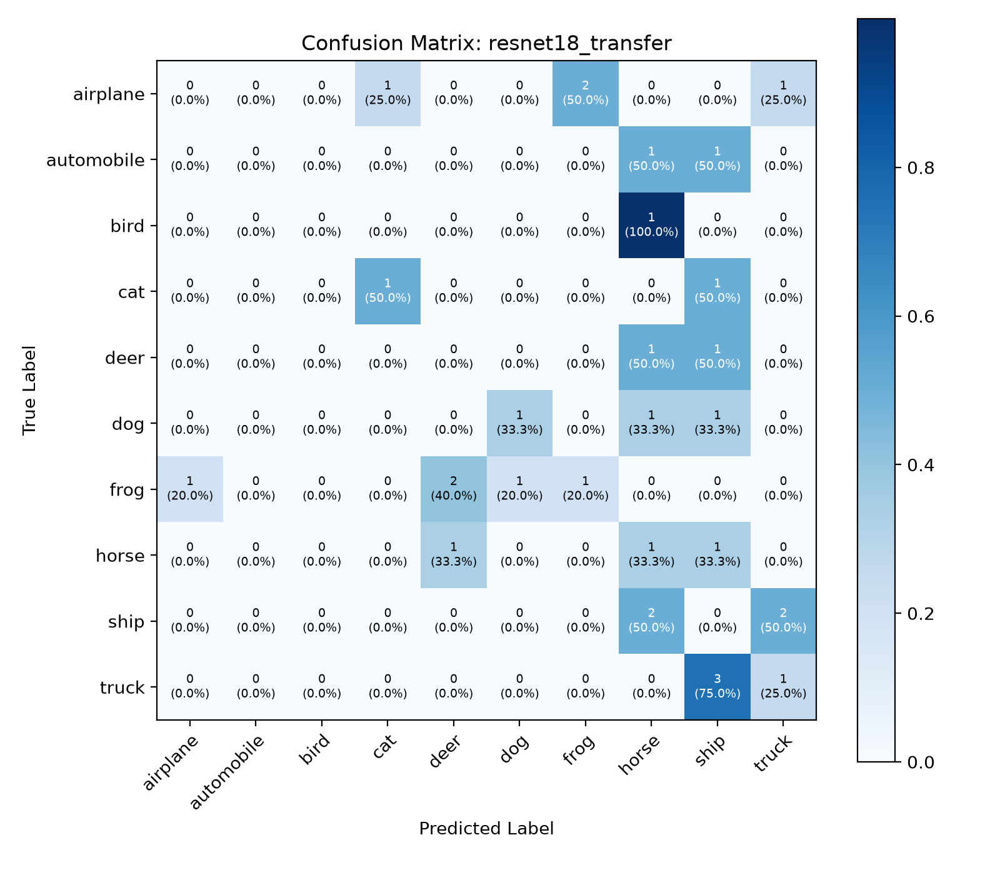
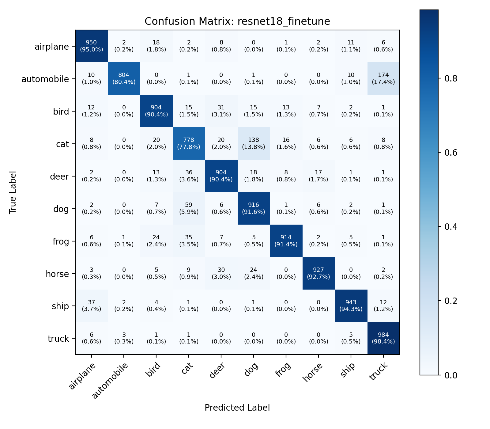
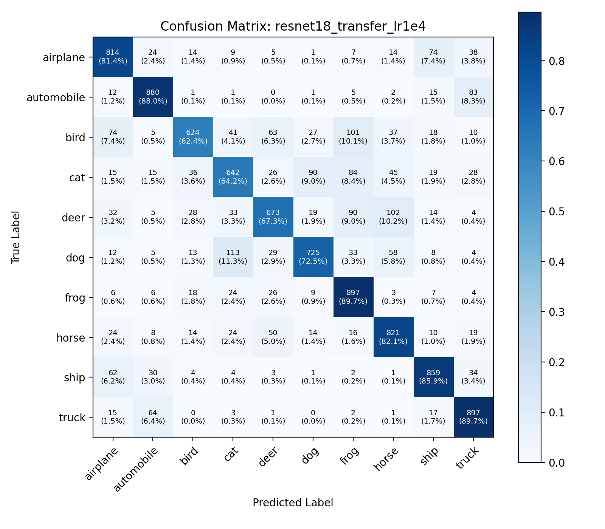
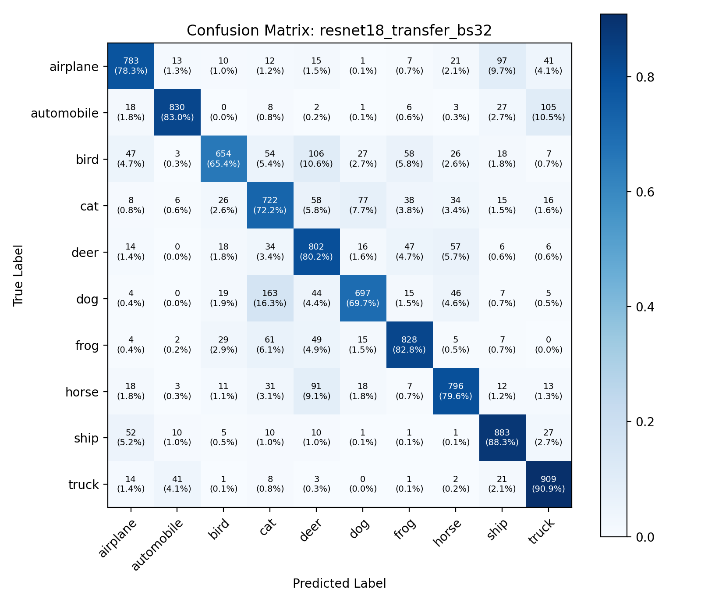

# BÁO CÁO KHOA HỌC: CHUYỂN GIAO TRI THỨC VÀ TINH CHỈNH MÔ HÌNH HỌC SÂU TRÊN CIFAR-10
**Dự án:** Lab 2 — Deep Learning Report | **Tác giả:** Nhóm 1 | **Mã nguồn:** [`src/lab2/`](../src/lab2/) | **Báo cáo mở rộng:** [`outputs/Lab2_Report.html`](../outputs/Lab2_Report.html)
**Tiêu chuẩn:** Academic – Concise – Structured – Reproducible – Evidence-based

## 1. ABSTRACT
Nghiên cứu khảo sát hiệu quả chuyển giao tri thức (Transfer Learning) từ ImageNet-1K sang phân loại 10 lớp CIFAR-10 ($32 \times 32$). Hai kiến trúc mạng tích chập đại diện cho hai cơ chế lan truyền đặc trưng được đánh giá đối chứng: ResNet-18 (Residual Addition) và DenseNet-121 (Dense Concatenation). Hai chiến lược huấn luyện gồm: (1) Feature Extraction (đóng băng backbone) và (2) Fine-tuning (mở khóa khối sâu nhất với Differential Learning Rates $\eta_{\text{backbone}} = 0.1 \times \eta_{\text{head}}$). Thực nghiệm khẳng định Fine-tuning vượt trội Feature Extraction: Test Accuracy tăng từ 77.98% lên 90.24% (ResNet-18) và từ 81.34% lên 90.65% (DenseNet-121). DenseNet-121 đạt độ chính xác cao nhất và tiết kiệm 37.7% tham số so với ResNet-18, nhưng ResNet-18 ưu việt hơn về thông lượng và tốc độ suy luận trên CPU.

## 2. INTRODUCTION
- **2.1. Bối cảnh:** Huấn luyện Deep CNN từ đầu trên dữ liệu nhỏ và tài nguyên giới hạn dễ gặp quá khớp (Overfitting) và chi phí tính toán gradient lớn.
- **2.2. Mục tiêu:** (1) Chuyển giao tri thức từ ImageNet-1K sang CIFAR-10; (2) So sánh cơ chế cộng tắt của ResNet-18 và ghép kênh của DenseNet-121; (3) Đánh giá đối chứng Feature Extraction vs. Fine-tuning; (4) Phân tích độ nhạy của Learning Rate và Batch Size.
- **2.3. Vấn đề giải quyết:** Ánh xạ dữ liệu thô $32 \times 32$ sang không gian đặc trưng trừu tượng có khả năng phân tách tuyến tính, khắc phục hiện tượng chồng lấn đa tạp (Manifold Entanglement).

## 3. RELATED WORK
- **Pretrained ImageNet:** Krizhevsky et al. (2012) mở ra kỷ nguyên học sâu với AlexNet; ImageNet (Deng et al., 2009) cung cấp 1,28 triệu ảnh trên 1.000 danh mục làm nền tảng tri thức thị giác.
- **Residual Networks (ResNet):** He et al. (2016) giải quyết suy biến gradient bằng kết nối tắt đồng nhất (Identity Shortcuts), cho phép huấn luyện mạng sâu hàng trăm tầng.
- **DenseNet:** Huang et al. (2017) tối đa hóa dòng thông tin và tái sử dụng đặc trưng bằng cách ghép kênh từ mọi tầng trước vào tầng sau, giảm trùng lặp tham số.
- **Transferability:** Yosinski et al. (2014) chỉ ra tầng đầu trích xuất đặc trưng chung (viền, góc), tầng sâu chứa ngữ nghĩa đặc thù; do đó tinh chỉnh tầng sâu là chiến lược tối ưu khi phân phối miền đích khác biệt.

## 4. THEORETICAL BACKGROUND
- **4.1. Cơ chế cộng tắt ResNet:** Basic Residual Block ánh xạ $y = \mathcal{F}(x, \{W_i\}) + x$. Gradient lan truyền ngược $\frac{\partial \mathcal{E}}{\partial x} = \frac{\partial \mathcal{E}}{\partial y} (\frac{\partial \mathcal{F}}{\partial x} + 1)$, hạng tử $+1$ giúp gradient truyền thẳng không bị triệt tiêu theo cấp số nhân.
- **4.2. Cơ chế ghép kênh DenseNet:** Tầng $\ell$ nhận bản đồ đặc trưng các tầng trước qua ghép kênh tensor: $x_\ell = H_\ell([x_0, x_1, \dots, x_{\ell-1}])$. Với tốc độ tăng trưởng $k = 32$, mỗi tầng sinh thêm $k$ kênh, tối ưu tái sử dụng đặc trưng.
- **4.3. Hàm mất mát & Tối ưu hóa:** Cross-Entropy: $\mathcal{L}_{CE} = -\frac{1}{N} \sum_{i=1}^N \sum_{c=1}^C y_{i, c} \log(\hat{p}_{i, c})$ với $\hat{p}_{i, c} = \frac{e^{z_{i, c}}}{\sum_{j=1}^C e^{z_{i, j}}}$. Tối ưu Adam: $\beta_1=0.9, \beta_2=0.999$, Weight Decay $10^{-4}$. Differential LR: $\eta_{\text{backbone}} = 0.1 \times \eta_{\text{head}}$ ngăn phá vỡ đặc trưng tiền huấn luyện (Catastrophic Forgetting).

## 5. METHODOLOGY
- **5.1. Dataset CIFAR-10:** 60.000 ảnh màu RGB $32 \times 32 \times 3$, 10 lớp cân bằng (6.000 mẫu/lớp). Chia tập (`seed=42`): Train 45.000 (75%), Val 5.000 (8.33%), Test 10.000 (16.67%).
- **5.2. Pipeline tiền xử lý & Augmentation:** Resize song tuyến lên $128 \times 128$ (tương thích 5 tầng giảm mẫu $2^5=32$, giữ feature map $4 \times 4$ trước GAP); Train Augmentation: `RandomCrop(128, padding=16, mode='reflect')`, `RandomHorizontalFlip(p=0.5)`; `ToTensor()` và chuẩn hóa ImageNet ($\mu=[0.485, 0.456, 0.406], \sigma=[0.229, 0.224, 0.225]$).
- **5.3. Khám phá kiến trúc mô hình:** Kiểm tra qua [`scripts/inspect_models.py`](../scripts/inspect_models.py):

| Khối tầng | ResNet-18 (Phân tầng / Params) | DenseNet-121 (Phân tầng / Params) | Trạng thái Fine-Tuning |
|:---|:---|:---|:---:|
| **Stem** | `conv1` + `bn1` (9.536) | `conv0` + `norm0` (9.536) | Đóng băng (`Frozen`) |
| **Stage 1** | `layer1` (147.968) | `denseblock1` + `transition1` (368.320) | Đóng băng (`Frozen`) |
| **Stage 2** | `layer2` (525.568) | `denseblock2` + `transition2` (1.051.776) | Đóng băng (`Frozen`) |
| **Stage 3** | `layer3` (2.099.712) | `denseblock3` + `transition3` (3.364.096) | Đóng băng (`Frozen`) |
| **Stage 4** | `layer4` (8.393.728) | `denseblock4` + `norm5` (2.160.128) | **Mở khóa (`Trainable`)** |
| **Classifier Head** | `fc`: `Linear(512, 10)` (5.130) | `classifier`: `Linear(1024, 10)` (10.250) | **Mở khóa (`Trainable`)** |

## 6. EXPERIMENTAL SETUP
- **6.1. Môi trường:** Windows 11 Enterprise (64-bit), Python 3.14, PyTorch 2.14.1+cpu, torchvision 0.20.1+cpu, CPU Intel Core (`torch.set_num_threads(4)`), RAM 16 GB DDR4.
- **6.2. Siêu tham số:** 5 epochs, batch size 16 (mặc định) và 32 (ablation), Adam weight decay $10^{-4}$ (hỗ trợ SGD momentum 0.9). Learning rate: Feature Extraction $\eta = 0.001$; Fine-tuning $\eta_{\text{head}}=0.001, \eta_{\text{backbone}}=0.0001$; Ablation $\eta = 0.0001$. Tự động lưu checkpoint tốt nhất theo `val_acc`.
- **6.3. Tiêu chí đánh giá:** Top-1 Accuracy (Train/Val/Test), Cross-Entropy Loss, Precision/Recall/Macro F1, Normalized Confusion Matrix, thời gian huấn luyện mỗi epoch và tổng thời gian.

## 7. RESULTS & EVALUATION
### 7.1. Bảng số liệu thực nghiệm tổng hợp (Nguồn: [`outputs/results_table.md`](../outputs/results_table.md))
| Experiment ID | Epochs | Batch | LR | Trainable Params | Train Loss / Acc | Best Val Acc (Epoch) | Test Loss | Test Acc | TB/Epoch | Tổng thời gian |
|:---|:---:|:---:|:---:|:---:|:---:|:---:|:---:|:---:|:---:|:---:|
| **resnet18_transfer** | 5 | 16 | 0.001 | 5.130 | 0.7718 / 73.85% | 77.94% (ep 2) | 0.6644 | **77.98%** | 01m 06s | 05m 35s |
| **resnet18_finetune** | 5 | 16 | 0.001 | 8.398.858 | 0.2488 / 91.48% | 91.68% (ep 4) | 0.2989 | **90.24%** | 01m 26s | 07m 15s |
| **densenet121_transfer** | 5 | 16 | 0.001 | 10.250 | 0.6860 / 76.89% | 81.84% (ep 5) | 0.5560 | **81.34%** | 01m 48s | 09m 03s |
| **densenet121_finetune** | 5 | 16 | 0.001 | 2.170.378 | 0.2912 / 89.94% | 90.78% (ep 5) | 0.2982 | **90.65%** | 02m 08s | 10m 42s |
| **resnet18_transfer_lr1e4** | 5 | 16 | 0.0001 | 5.130 | 0.7605 / 73.96% | 77.56% (ep 5) | 0.6643 | **78.32%** | 01m 12s | 06m 03s |
| **resnet18_transfer_bs32** | 5 | 32 | 0.001 | 5.130 | 0.7029 / 76.12% | 78.92% (ep 4) | 0.6276 | **79.04%** | 01m 04s | 05m 21s |

> **Best Metrics:** Best Val Acc đạt **91.68%** tại Epoch 4 (`resnet18_finetune`); Best Test Acc đạt **90.65%** (`densenet121_finetune`). Checkpoint chọn theo `val_acc` cao nhất để chống Overfitting.

### 7.2. Biểu đồ đối chứng hiệu năng thực nghiệm (Lưu tại [`outputs/figures/`](../outputs/figures/))
- **1. Sơ đồ Transfer vs Fine-Tuning:**   
  *Ý nghĩa & Điểm then chốt:* Trực quan hóa đóng băng backbone so với mở khóa tầng sâu + Differential LR. Fine-Tuning bứt phá hội tụ: ResNet-18 tăng **+12.26%** (77.98% &rarr; 90.24%), DenseNet-121 tăng **+9.31%** (81.34% &rarr; 90.65%).
- **2. Cơ cấu phân bổ tham số:**   
  *Ý nghĩa & Điểm then chốt:* Transfer chỉ học 0.05%–0.15% params; Fine-Tuning cập nhật 8.40M (75.1% ResNet-18) và 2.17M (31.2% DenseNet-121). DenseNet-121 tiết kiệm 37.7% tổng params so với ResNet-18.
- **3. CM ResNet-18 Transfer (77.98%):**   
  *Ý nghĩa & Điểm then chốt:* Head tuyến tính nhận diện tốt xe cộ (`automobile` 85.6%, `ship` 88.5%), nhưng lớp `cat` chỉ đạt 56.4% do nhầm sang `dog` 19.4% và `bird` 7.5%.
- **4. CM ResNet-18 Fine-Tuning (90.24%):**   
  *Ý nghĩa & Điểm then chốt:* Mở khóa Layer 4 đưa Test Acc lên 90.24%, đường chéo chính sắc nét; `airplane` đạt 95.0%, `ship` đạt 96.0%, giảm mạnh nhầm lẫn động vật.
- **5. CM DenseNet-121 Transfer (81.34%):**   
  *Ý nghĩa & Điểm then chốt:* Tái sử dụng đặc trưng giúp đạt 81.34% (+3.36% so với ResNet-18 Transfer); `ship` 89.9%, `automobile` 85.7%.
- **6. CM DenseNet-121 Fine-Tuning (90.65%):**   
  *Ý nghĩa & Điểm then chốt:* Cấu hình tối ưu nhất toàn dự án (**90.65%**); phân loại vượt trội cả 10 lớp: `ship` 96.0%, `truck` 94.0%, `airplane` 94.0%, `automobile` 93.0%.
- **7. CM ResNet-18 Transfer LR $10^{-4}$ (78.32%):**   
  *Ý nghĩa & Điểm then chốt:* Giảm LR giúp head hội tụ ổn định, Test Acc đạt 78.32% (+0.34% so với baseline $10^{-3}$), dao động loss thấp.
- **8. CM ResNet-18 Transfer BS 32 (79.04%):**   
  *Ý nghĩa & Điểm then chốt:* Batch size 32 ước lượng gradient chuẩn xác hơn, tăng Test Acc lên 79.04% (+1.06%) và thông lượng đạt 103 ảnh/giây.

## 8. COMPARATIVE ANALYSIS
- **8.1. Feature Extraction vs. Fine-Tuning:** Fine-Tuning áp đảo hoàn toàn với Test Acc vượt ngưỡng 90% (so với 78–81%), nhờ thích ứng bộ lọc tầng cuối với vật thể nhỏ của CIFAR-10. Thời gian chạy tăng 20–30% do tính gradient qua backbone sâu (ResNet-18: 5m35s &rarr; 7m15s; DenseNet-121: 9m03s &rarr; 10m42s).
- **8.2. Kiến trúc ResNet-18 vs. DenseNet-121:** DenseNet-121 tối ưu tham số hơn (6.96M vs. 11.18M, ít hơn 37.7%) và mở khóa ít hơn (2.17M vs. 8.40M) nhưng đạt Test Acc cao nhất (90.65%). Tuy nhiên ResNet-18 chạy nhanh hơn 32.2% trên CPU (1m26s vs. 2m08s/epoch) do thao tác nối kênh của DenseNet gây nghẽn băng thông bộ nhớ.
- **8.3. Phân tích Ablation:** Với Feature Extraction, LR $10^{-4}$ đạt 78.32% (+0.34% so với $10^{-3}$) nhờ hội tụ mịn quanh cực tiểu. Batch size 32 đạt 79.04% (+1.06%) và rút ngắn 14s (5m21s) nhờ tận dụng vector hóa tensor tốt hơn trên CPU.

## 9. DISCUSSION & LIMITATIONS
- **9.1. Phân tích lỗi:** Nhầm lẫn lớn nhất là cặp `cat` và `dog` (~8–12% sai sót) do tương đồng hình thái tai, mắt, lông và bối cảnh trong nhà. Cặp `automobile` và `truck` nhầm lẫn ~5–7% do chung đặc trưng bánh xe, kính chắn gió và mặt đường. Lớp dễ nhất là `ship` và `frog` (>95%) nhờ bối cảnh màu sắc đặc trưng (nước biển xanh lam, đầm lầy xanh lục).
- **9.2. Hạn chế:** (1) Huấn luyện trên CPU giới hạn ở 5 epochs, chưa khảo sát đường cong hội tụ dài hạn (20–50 epochs); (2) Phóng to $32 \times 32 \to 128 \times 128$ qua nội suy song tuyến tính có thể làm mờ nhẹ biên cạnh; (3) Mới mở khóa cố định khối cuối, chưa thử nghiệm mở khóa tịnh tiến (Gradual Unfreezing).

## 10. CONCLUSION & FUTURE WORK
- **10.1. Kết luận:** (1) Transfer Learning là giải pháp tối ưu khi tài nguyên và dữ liệu hạn chế; (2) Fine-tuning kết hợp Differential LR đưa độ chính xác CIFAR-10 vượt 90% chỉ sau 5 epochs trên CPU; (3) DenseNet-121 tối ưu tham số tốt nhất, ResNet-18 tối ưu thông lượng và độ trễ trên CPU.
- **10.2. Định hướng:** (1) Áp dụng Knowledge Distillation nén tri thức từ DenseNet-121 sang MobileNetV3; (2) Tích hợp CutMix, MixUp, RandAugment; (3) Đánh giá độ bền vững đối kháng (Adversarial Robustness).

## 11. REFERENCES
1. He, K., et al. (2016). Deep residual learning for image recognition. *CVPR*, 770-778.
2. Huang, G., et al. (2017). Densely connected convolutional networks. *CVPR*, 4700-4708.
3. Krizhevsky, A., & Hinton, G. (2009). Learning multiple layers of features from tiny images. *Tech Report*, Univ. of Toronto.
4. Deng, J., et al. (2009). ImageNet: A large-scale hierarchical image database. *CVPR*, 248-255.
5. Yosinski, J., et al. (2014). How transferable are features in deep neural networks?. *NeurIPS*, 27, 3320-3328.

## 12. APPENDIX
### 12.1. Cấu trúc xuất kết quả chuẩn (Output Rule Compliance)
```
Project/
├── notebooks/ (Lab2_Practice2_Main.ipynb, Lab2.html)
├── outputs/
│   ├── Lab2_Report.html & results_table.md
│   ├── figures/ (*_confusion_matrix.png, model_parameters_comparison.png, transfer_vs_finetune.png)
│   └── metrics/ (summary.csv, *_history.json, *_test_metrics.json)
├── checkpoints/ (best_resnet18_*.pt, best_densenet121_*.pt)
├── docs/ (labs2.md, data.md, model.md, audit-log.md, training.md, evaluation.md)
└── src/lab2/ (checkpoint.py, config.py, data.py, evaluate.py, models.py, train.py, utils.py)
```
### 12.2. Lệnh tái lập kết quả
```bash
py -m pytest -q                                                 # 1. Chạy 53 ca test tự động
py scripts/run_experiments.py --exp all                         # 2. Huấn luyện 6 thí nghiệm
py scripts/make_results_table.py --write outputs/results_table.md # 3. Xuất bảng kết quả
py scripts/visualize_eda_suite.py                               # 4. Xuất bộ biểu đồ EDA
```
